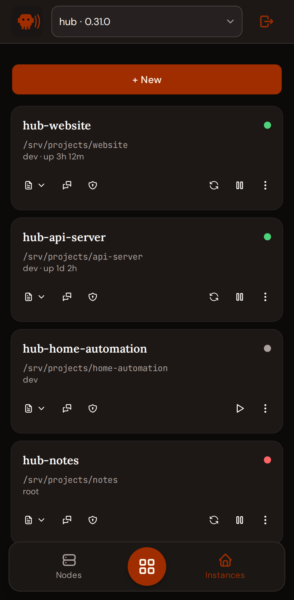
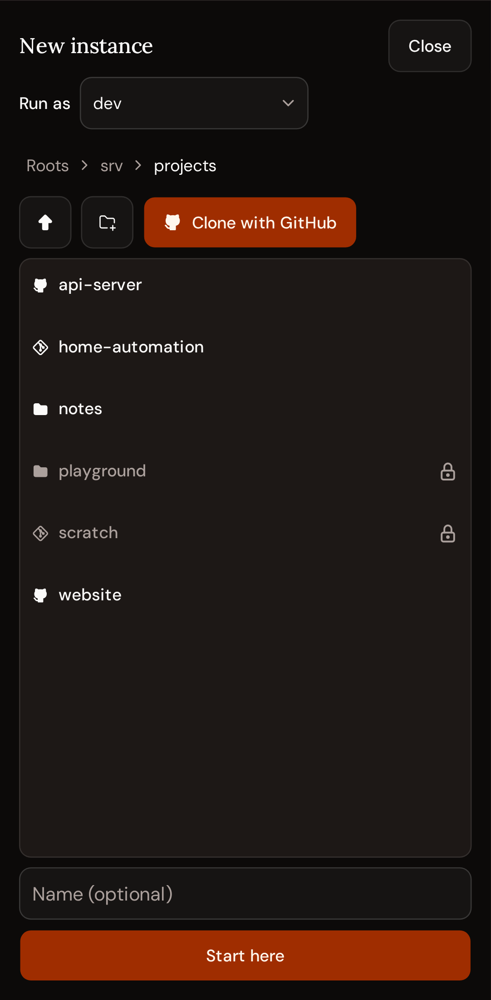
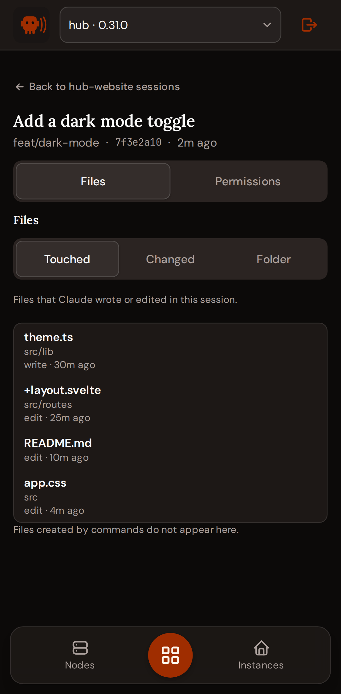
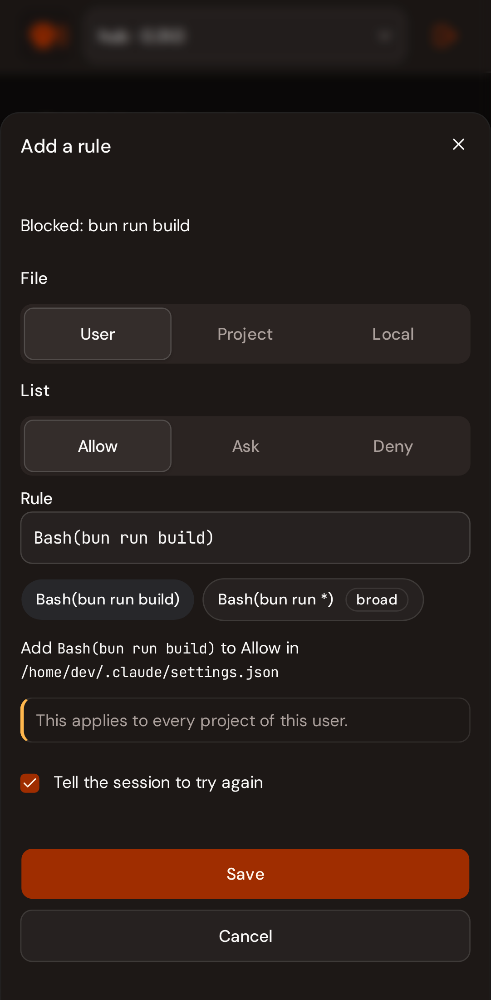
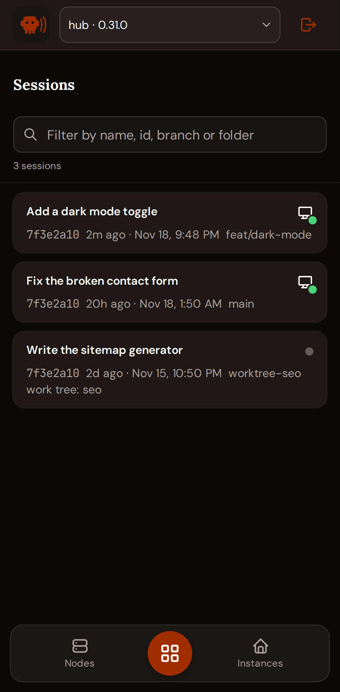
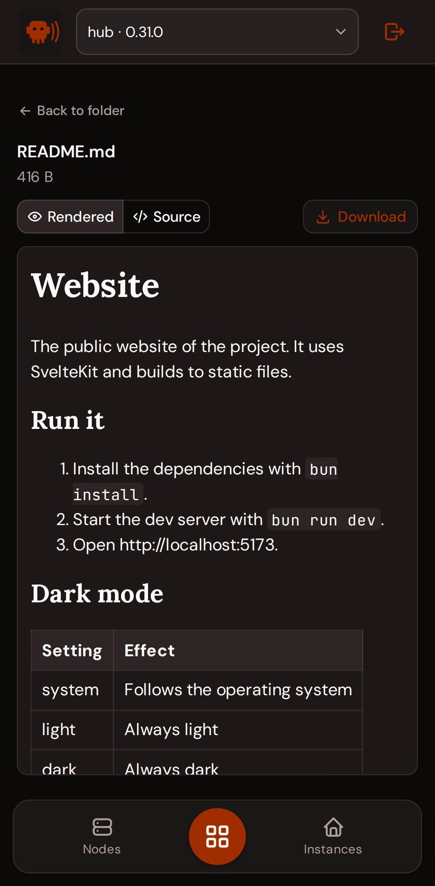
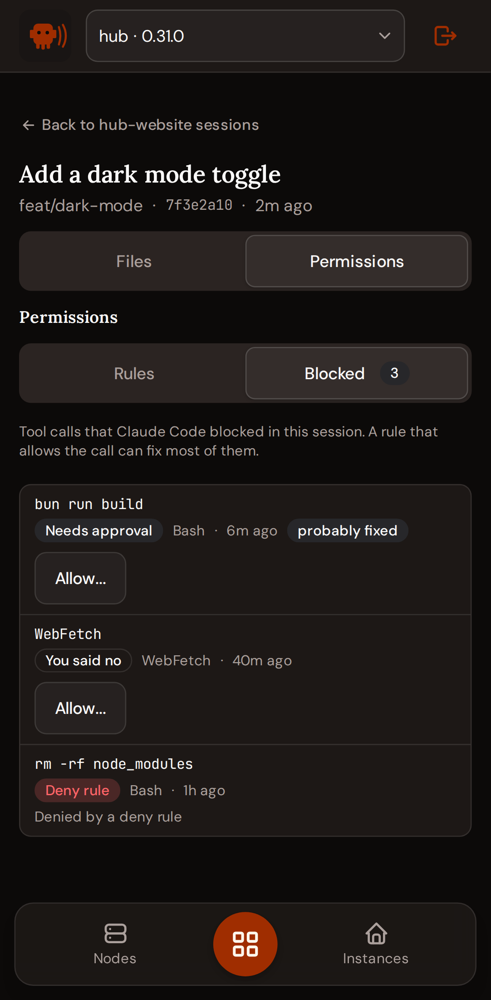
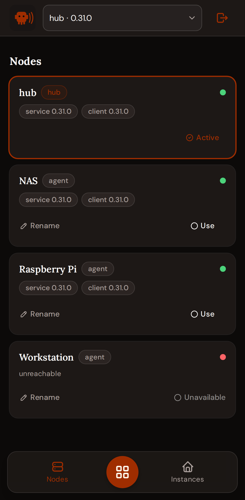

# Claude RC Launcher

Start, watch and stop Claude Code Remote Control servers on your own machines, from your phone.

`claude remote-control` lets you work with a Claude Code session from the Claude app or from claude.ai. But somebody must start it in the right folder on the right machine first, and keep it running. Claude RC Launcher does that part. You open a web page on your phone, pick a folder on one of your machines, and tap Start. The launcher runs `claude remote-control` there as a service. The session then shows up in the Claude app.

<p>




</p>

## Features

- Start an instance in any allowed folder, and pick the user that runs it. Each instance is a systemd service that survives a reboot.
- Browse folders with icons for git and GitHub repositories, make new folders, and trust a folder for Claude Code.
- Clone a GitHub repository into a new folder and start an instance in it, with a device login to GitHub from your phone.
- Restart, pause, resume and stop instances, and read their logs.
- Recover the sessions of a server after a crash or a restart.
- Choose per instance whether the server makes a session at start, and whether each session gets its own git worktree.
- See the sessions of an instance, the files that Claude touched, the files that git shows as changed, and the whole folder. Markdown files show rendered and code shows with colors.
- See the tool calls that Claude Code blocked, and add an allow, ask or deny rule from your phone. The session can then try again at once.
- Manage many machines from one hub: Linux nodes and Windows nodes.
- Update the hub, every node and every client from the web UI or with one command.
- Log in with any OIDC provider, or behind a forward-auth proxy that sends a signed JWT. Three roles: `read`, `write` and `admin`.
- A command-line client, `claude-rc`, for instances, folders, clones, nodes and updates.
- A phone-first web UI that you can install as an app. It has four color themes with light and dark modes.

Read [Using the web UI](docs/web-ui.md) for a tour of every screen.

<p>




</p>

## How it works



- The hub is one binary that serves the web UI and a JSON API on one port. It runs behind your reverse proxy, which terminates TLS.
- An instance is one `claude remote-control` process in one folder. On Linux it is a systemd unit, `claude-rc-<id>.service`. On a Windows node, the node service supervises it.
- A node is the same binary in node mode, on another machine. The hub talks to each node over HTTPS with a pinned certificate.
- The browser and the CLI talk only to the hub. A node accepts requests only from the hub.

The compiled binary contains the web UI. The server needs no Node.js and no Bun at runtime.

## Quick start

You need these things: a Linux host with systemd, an OIDC provider, and a reverse proxy with TLS. Claude Code must be installed and signed in for the run-as user.

1. Download the binary and check it:

   ```sh
   ARCH=$(uname -m | sed -e 's/x86_64/x64/' -e 's/aarch64/arm64/')
   BASE=https://github.com/kbirger/claude-rc-launcher/releases/latest/download
   curl -fsSLO "$BASE/claude-rc-launcher-linux-$ARCH" -O "$BASE/SHA256SUMS"
   sha256sum --ignore-missing -c SHA256SUMS
   ```

2. Make an OIDC client for the hub in your identity provider. With authentik, the [setup script](#authentik-setup-script) does it for you.
3. Get a clone of this repository at the tag of the release. In the clone, install the binary and the service. The script copies the binary to `/usr/local/bin`, creates `/etc/claude-rc-launcher/config.toml`, and tells you what to fill in:

   ```sh
   sudo deploy/install-binary.sh --service path/to/claude-rc-launcher-linux-$ARCH
   ```

4. Fill in `public_url` and the OIDC values in `config.toml`, put the client secret in `oidc-client.secret` (mode 600), and run the same command again. It starts the service.
5. Point your reverse proxy at port 8080 and open `public_url` on your phone.

[Install](docs/install.md) has every option, including a build from source and the Windows node.

## Authentication and roles

The hub has no passwords. An OIDC identity provider logs the user in, and the hub reads one claim from the ID token to set the role:

| Role | Can do |
|---|---|
| `read` | See instances, logs, files, sessions and update status. |
| `write` | Also start, stop, pause, resume and restart instances, make folders, clone repositories, and change permission rules. |
| `admin` | Also add and remove nodes, run updates, start a GitHub login on a host, and start an instance as a user other than `instance.service_user`. |

The web login is the authorization code flow with PKCE, with a confidential client and an `https` issuer. The provider must put one custom claim in the ID token. Any OIDC provider that can do this works. The claim name, the scope that asks for it, and a map from group names to roles are all configurable. A user with no claim gets `user_auth.default_role`, which is `read` by default.

The CLI uses a second, public OIDC client with PKCE, a loopback redirect and a refresh token. The hub does not store CLI sessions. The IdP decides how long a CLI login lives, and can revoke it.

[Authentication](docs/authentication.md) has the requirements for any provider, the roles, and examples.

### Forward auth with a signed JWT

If a forward-auth proxy already protects your services, set `user_auth.mode = "proxy-jwt"`. The proxy logs the user in and sends a signed JWT in a header, for example `X-authentik-jwt` from the authentik proxy outpost. The hub does not trust the proxy or any plain header such as `X-authentik-username`. It checks the signature of the JWT against a JWKS URL from its own configuration, and it checks the issuer, the audience and the expiry. An optional list of trusted peers can also limit the addresses that can send requests. The roles work in the same way as in OIDC mode.

## Security model

A `write` or `admin` login can run Claude Code, and so any command, as the run-as user on the hub and on every node. The default run-as user is `root`, so set a non-root `instance.service_user` where you can. Treat the hub like an SSH server. Read [Security](docs/security.md) before you expose it.

Between the hub and the nodes:

- The hub has its own Ed25519 key. A node trusts the public key of the hub and nothing else. A node never talks to the IdP and never sees a user token.
- The hub signs a new proof for each request to a node. The proof is valid for 30 seconds, for one node, one method, one path and one body, and for the fingerprint of the node certificate. The node rejects a proof that it saw before. A proof that one node receives is useless at any other node.
- The proof carries the user and the role that the hub acts for. The node writes both to its audit log.
- The hub pins the certificate of each node. TLS between the hub and a node is mandatory.
- A node enforces its own allowed folders (`instance.roots`), whatever the hub asks.
- To cut the hub off from a node, remove the hub key from that node.

A shared secret is a weaker second method for a node that you set up by hand. [Multiple hosts](docs/multi-host.md) explains pairing, shared secrets and key rotation.

## Command-line client

`claude-rc` starts, lists and stops instances, browses folders, clones repositories and changes instance settings from any terminal. It also pairs nodes, sets up a new node, and updates every machine. Pause, resume, restart, sessions, files and permissions are in the web UI only.

```sh
curl -fsSL https://raw.githubusercontent.com/kbirger/claude-rc-launcher/main/install-cli.sh | sh
claude-rc login --hub https://rc.example.com
claude-rc hosts                                  # every host and its status
claude-rc ls /srv/projects                       # folders, with a lock on untrusted ones
claude-rc start /srv/projects/website --name website
claude-rc clone owner/repo /srv/projects         # clone and start
claude-rc logs <id> --lines 50
claude-rc stop <id>
claude-rc update --all-nodes                     # every node, then the hub, then this client
```

To turn a new Linux machine into a node in one step, run this on that machine:

```sh
claude-rc node setup --hub https://rc.example.com --listen 192.168.1.20 --name nas --roots /srv/projects
```

It installs the binary, writes the configuration with the hub public key, starts the service, and registers the node with the hub. [Command-line client](docs/cli.md) lists every command and flag.

## Authentik setup script

If you use authentik, one script sets up everything for the hub: the web provider and application, the CLI provider and application, the role claim mapping, three role groups, and the access bindings. It shows a plan first and changes nothing until you pass `--apply`. You can run it again. It changes only what differs.

```sh
export AUTHENTIK_URL=https://auth.example.com
export AUTHENTIK_TOKEN=<an API token of an admin>
bun scripts/authentik-setup.ts --public-url https://rc.example.com --admin-user alex            # shows the plan
bun scripts/authentik-setup.ts --public-url https://rc.example.com --admin-user alex --apply    # makes the changes
```

The script writes the client secret to a file with mode 600 and never prints it. With `--write-hub-config /etc/claude-rc-launcher` it also writes the OIDC keys into `config.toml`, after a backup. `--interactive` asks questions instead of flags. Read [Authentik setup script](docs/authentication.md#authentik-setup-script).

## Documentation

- [Using the web UI](docs/web-ui.md)
- [Command-line client](docs/cli.md)
- [Install](docs/install.md)
- [Configuration](docs/configuration.md)
- [Authentication](docs/authentication.md)
- [Multiple hosts](docs/multi-host.md)
- [Updates](docs/updates.md)
- [Reverse proxy](docs/reverse-proxy.md)
- [Security](docs/security.md)
- [HTTP API](docs/api.md)
- [Development](docs/development.md)

## Development

Only [Bun](https://bun.sh) is needed. The version is pinned in `.bun-version`.

```sh
./install.sh            # installs Bun if needed, then the dependencies
bun run test            # server and CLI tests, and the web tests
bun run build           # dist/claude-rc-launcher with the web UI inside
```

[Development](docs/development.md) has the rest, including releases.
