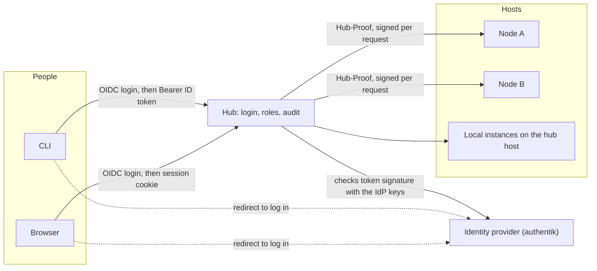
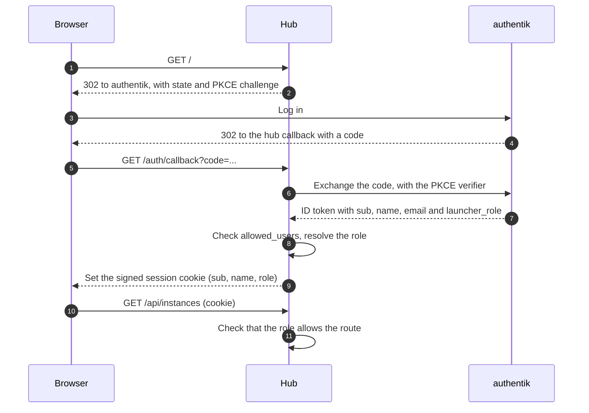
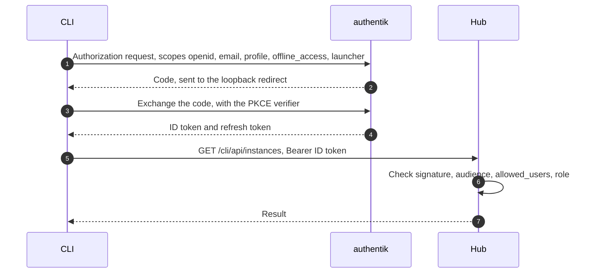
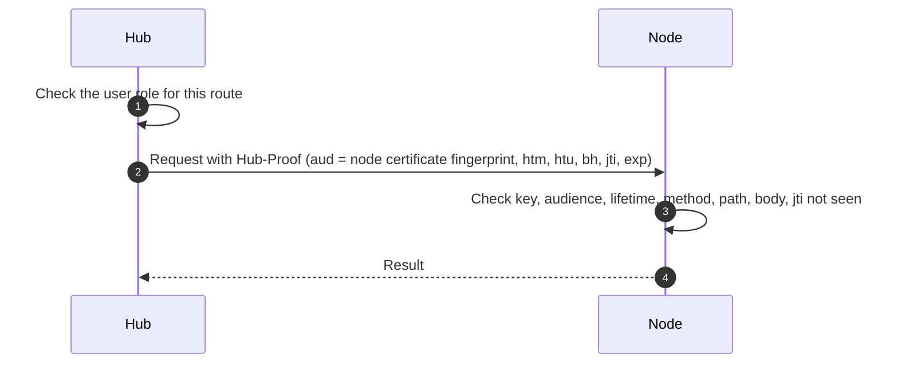
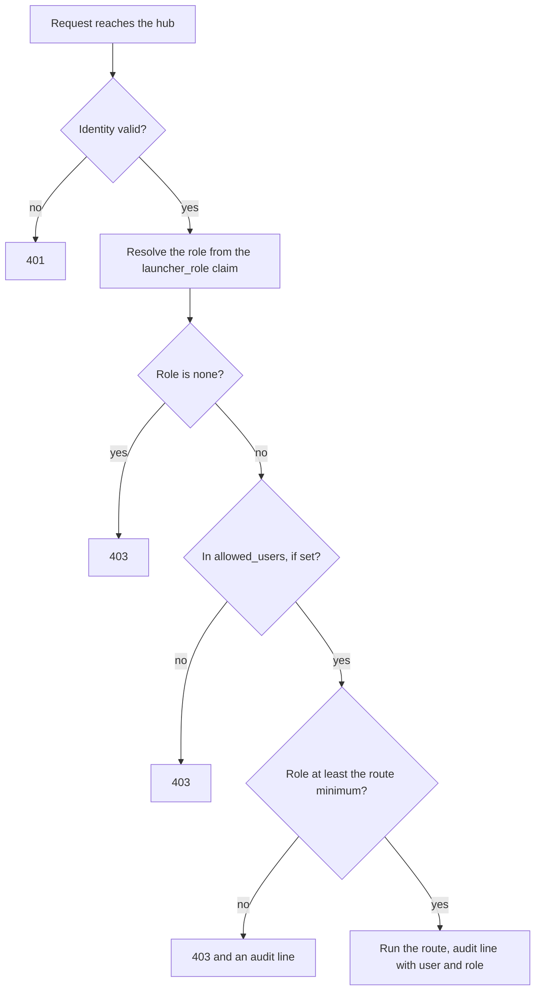

# Authentication and authorization architecture

Status: draft target design, 2026-11-15. Parts marked Built exist in the code today. Parts marked Planned do not.

This document describes who can do what in Claude RC launcher, and which component decides it. The diagrams use Mermaid. GitHub renders them.

## Summary

Three kinds of caller reach the system: a person in a browser, a person at the command line, and the hub itself. The identity provider (IdP) proves who the person is. In our deployment the IdP is authentik. The hub decides what that person can do. A node (an agent host) trusts the hub and nothing else.

A person has one of three roles: read, write, or admin. The IdP sets the role through one extra claim in the login token. The hub enforces the role on every route.

The claim is the authority for access. Nothing in this design depends on authentik. Any OIDC provider that can add one claim to a token works. See "Using another identity provider".

## Components and trust

The hub is the only component that talks to the IdP. A node never talks to the IdP. If a request carries no proof that the hub signed, a node rejects it.



Trust rules:

1. The hub trusts the IdP signing keys for identity and role.
2. A node trusts the hub public key and no IdP key.
3. When you add a node, the hub pins the certificate of that node. The hub trusts the node through that certificate alone.
4. The hub never sends a credential that a node or an attacker can replay at another component.

## Principals

| Principal | How it proves itself | Where it is checked |
|---|---|---|
| Browser user | Session cookie, signed by the hub, valid 12 hours. The hub sets it after an OIDC login. Built | Hub |
| Browser user behind a proxy | Signed JWT in a header from the authentik proxy outpost (`proxy-jwt` mode). Built | Hub |
| CLI user | `Authorization: Bearer <ID token>` of the public CLI client, on `/cli/api` only. Built | Hub |
| Hub, toward a node | `Authorization: Hub-Proof <jwt>`, signed with the hub Ed25519 key. Built | Node |
| Hub, toward a node with no IdP | `Authorization: Bearer <shared secret>`. Built. Weaker, for hand-made nodes and for deployments with no IdP | Node |

## Browser login

The hub does not keep the IdP tokens. It copies the claims that it needs into a signed cookie and drops the tokens. A role change at the IdP therefore applies at the next login.



## CLI login

The CLI uses a separate public OIDC client with PKCE and a loopback redirect. The hub stores no CLI session. The hub checks the ID token on every request, so a role change applies as soon as the CLI gets a new ID token. The CLI keeps a refresh token on the user machine.



## Hub to node

The hub signs a new proof for each request. The proof names one node, one method, one path, and one body. It lives for 30 seconds. A node accepts each proof once.



Planned: the hub also puts `act_sub` (the user) and `act_role` (the role) into the proof. For work that no user started, such as the node watchers, the hub sets `act_sub` to `system`. The node writes both values to its audit log. In a later step, a node can refuse a write request from a user whose role is `read`. This is a second check. It adds no new trust, because a compromised hub can already sign any proof.

## Roles

The hub has three roles. Each role includes the roles that come before it in this table. A fourth claim value, `none`, refuses the person.

| Role | Can do |
|---|---|
| read | See instances, logs, files, the event stream, and update status |
| write | Everything in read, plus create, stop, pause, and resume instances, make folders, clone repositories, list GitHub repositories, and rename a node. A new instance runs as the default `service_user` of its node |
| admin | Everything in write. Also register and remove nodes, and run updates. Also start the GitHub login for a service user. Also start an instance as another user or as root |

Planned: every route on the hub declares its minimum role. The test walks the route table. If a route has no declared role, the test fails. This prevents a new route from shipping with no check.



## Where the role comes from

The role lives in authentik as an attribute on the user. A scope mapping is a short Python expression. Authentik runs it for each token. One scope mapping copies the attribute into the token. You attach the same mapping to the web provider and to the CLI provider. No second provider is needed.

```python
# Scope name: launcher
role = request.user.attributes.get("launcher_role", "")
return {"launcher_role": role}
```

How the hub treats the claim:

1. The claim has the value `read`, `write`, or `admin`. The hub uses it.
2. The claim has the value `none`. The hub refuses the person with 403. Use this value to turn off one person without a change to the policy bindings.
3. The claim is missing or empty. The hub uses `user_auth.default_role`.
4. The claim has any other value. The hub uses `read`.

The claim can be one text value or a list of text values. If it is a list, the hub uses the highest role in the list.

The hub asks for the scope `launcher` in both login flows. In `proxy-jwt` mode, you attach the mapping to the proxy provider, and the claim arrives in the signed JWT.

Authentik policy bindings on the application still decide who can log in at all. They cannot separate read from write, so the claim does that part.

## Who may sign in

Two checks decide whether a person gets in. The role claim is the main check. The list `user_auth.allowed_users` is an optional second check.

The claim is the authority. If the IdP sets the claim to `none`, the hub refuses the person. If the IdP policy does not admit the person, the person never reaches the hub.

The list `allowed_users` matches the username or the email in the token against the configured entries. If you set the list, both checks must pass. The list exists for an IdP that cannot limit which people can sign in to one application. With such an IdP, every person who has an account passes the IdP, so the list is the only gate.

If you use authentik, bind the application to the intended users or groups, and leave `allowed_users` unset. Then one place holds the access rules. The hub keeps the list for the IdPs that need it. The hub checks the list on every request, in all login modes. A person who you remove from the list loses access as soon as the hub runs with the new list.

## Using another identity provider

The hub needs three things from an IdP.

- An OIDC provider with an https issuer. It must support the authorization code flow with PKCE.
- A way to add one claim to the ID token. Authentik uses a scope mapping. Keycloak uses a protocol mapper. Entra ID and Okta use app roles or a groups claim. Auth0 uses an action.
- For the CLI, a public client with a loopback redirect (RFC 8252) and refresh tokens. Authentik accepts a regular expression for the redirect. Other IdPs accept any port on `127.0.0.1` through their own setting.

Three configuration keys adapt the hub to the IdP. `role_claim` names the claim. `role_scope` names the extra scope, and an empty value means that the hub requests none. `role_map` turns the claim values of the IdP into hub roles, for example a group name into `admin`. The README keeps the authentik steps in one appendix, and the rest of the text names no IdP.

## Configuration

Planned keys in the hub `config.toml`:

```toml
[user_auth]
default_role = "read"        # used when the token has no role claim
role_claim = "launcher_role" # name of the claim. A text value or a list of text values
role_scope = "launcher"      # extra scope that the hub requests. Empty means none
session_ttl_hours = 12       # browser cookie lifetime in hours. This is the built value
# allowed_users = [...]      # optional second check. Leave it out if the IdP limits sign-in

[user_auth.role_map]         # optional. Turns claim values into roles
"launcher-admins" = "admin"
"launcher-writers" = "write"
```

The default role is `read`. After an upgrade, every existing user is a reader until the IdP sends a role. Before you deploy, add the scope mapping to the web provider and the CLI provider. Then set `launcher_role = admin` on your own user. Deploy the hub after that, and sign in again, because the cookie holds the role. The release notes must say this.

## Revocation and limits

| Event | Effect |
|---|---|
| Role changed at the IdP | A browser user gets the new role at the next login. That is at most 12 hours later, or sooner with a shorter `session_ttl_hours`. To end all sessions at once, replace `session.secret`. A CLI user gets the new role with the next ID token |
| User removed from `allowed_users` | Access stops at the next request in every login mode. Review finding 9 is fixed |
| User disabled at the IdP | New logins fail. An existing browser cookie stays valid until it expires |
| Hub key leaked | An attacker can sign proofs for every node that trusts the key. Replace the `hub_key` row on each node |
| Node certificate leaked | An attacker can pose as that node toward the hub. The hub pins the certificate, so you replace it with `host add` again |
| Shared secret leaked | The attacker has full access to that node until you rotate the secret |

A login of any role reaches the hub with the access that its role grants. An admin login is root-equivalent on the hub and on every node, as the README warns.

## What is not in this design

- Per-host permissions. A role applies to every node.
- Token forwarding. The hub never sends a user token to a node. See "Why not forward the user token" below.
- Token storage. The hub keeps no access token and no refresh token for a browser user.
- Multi-tenant isolation. This tool is not built for hosts that serve many tenants.

## Why not forward the user token

The browser does not send a token. It sends a cookie that holds claims. To forward a token, the hub must store and refresh a token for each browser user. The CLI does send an ID token, but its audience is the CLI client and not a node. A node that receives it can replay it at the hub. The hub also acts without a user, because the node watchers keep a connection to each node and restart it after a failure. A signed proof per request avoids all four problems, and it keeps the nodes free of any IdP configuration.

## GitHub routes

GitHub support already exists. The node runs `gh` as the service user. `POST /github/login` starts the `gh` device login and stores a token in the home folder of that user. `GET /github/repos` lists repositories with that token. `POST /clone` clones with that token through the `gh` credential helper. The hub forwards all of these routes to a node. Each of the three routes takes an optional `user` field that names the service user.

None of these routes has a role today. The owner decided these rules for this phase:

| Route | Minimum role |
|---|---|
| `POST /github/login` and `GET /github/login/:id` | admin |
| `GET /github/repos` and `POST /clone` | write |

A clone only makes a folder with data that the node can already reach through its own `gh` login. It is the same kind of action as making a folder. A write user can use a login that an admin made. A write user cannot make or replace that login.

A request that names a `user` other than the default `service_user` of the node needs admin. This is the same rule as for a new instance. It also covers `POST /fs/mkdir`, which takes the same field.

Finer rules, such as a narrower token scope, are postponed. They are in `docs/superpowers/ideas/2026-11-15-github-management-roles.md`.

## Decisions

1. Default role. Decided: `read`. Before the deploy, the owner gets `launcher_role = admin` in authentik.
2. GitHub routes. Decided: the login needs admin, and listing repositories and cloning need write. Finer rules are postponed to a later task. The ideas file holds them.
3. Renaming a node. Decided: a write action. Registering and removing a node stay admin.
4. Cookie lifetime. Decided: the default stays at 12 hours. The new key `session_ttl_hours` lets an operator choose a shorter life. This is a small risk for one owner, and replacing `session.secret` ends all sessions at once. Review finding 9 is already fixed.
5. Unused authentik provider "Claude RC hub" (provider 24). Decided: delete it. The deletion is not done. The tools can delete the application `claude-rc-hub`, and they cannot delete the provider. The owner deletes both in the authentik admin page. The hub refuses a `[hub_auth]` table, and recent sign-in events show no use.
6. Access model. Decided: the role claim is the authority, and `allowed_users` is an optional second check.

## Build order

1. In authentik, add the scope mapping to the web provider (22) and the CLI provider (23). Set `launcher_role = admin` on the owner. Do this before any hub deploy.
2. Add the role to the user model and read it from the token in all three login modes. Include the `none` value, the list form, `role_map`, and `default_role`.
3. Add the minimum-role declaration to every route, and the test that walks the route table. Give the GitHub login routes admin, and the repository list and the clone route write. Add the `user` field rule for the GitHub routes, `POST /fs/mkdir`, and instance creation.
4. Add the audit line with the role, and the configuration keys, including `session_ttl_hours`.
5. Add `act_sub` and `act_role` to the hub proof, and log them on the node.
6. Add the web UI behavior: hide or disable actions that the role cannot do, such as the GitHub login button. The hub still enforces the role.
7. Write the setup steps into the README. Put the authentik steps in one appendix.
