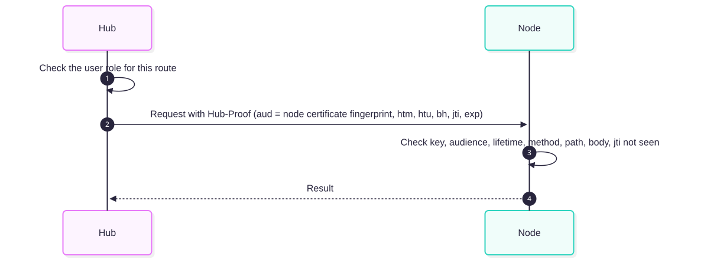

# Multiple hosts

One launcher, the hub, can manage instances on other machines, the nodes. A node is the same binary with `mode = "node"`. It has no web UI and no user login. A node can be a Linux machine or a Windows machine. The hub cannot run on Windows.



```
Browser -> reverse proxy [+ Authentik outpost] -> HUB -- HTTPS, pinned cert, Hub-Proof --> NODE
```

The hub serves the UI and proxies the instance API of each node. If more than one host is configured, a Nodes button appears above the
Sessions and Instances lists. Its menu has a checkbox for each host. Each host has a status dot, and an offline host stays in the menu.
The hub's own host is the
implicit host `local`.

## Session lists from nodes

The hub keeps the last list of sessions of each host in memory. A node sends its list over the event stream that the hub already holds (`GET /api/events`). The `snapshot` event has a field `sessions` with the full list. After that, the node sends a `sessions` event with the full list each time the list changes. The body is `{ scannedAt, available, sessions }`. A node with no session files sends `available: false`. The hub shows such a host as `unavailable`. If the list is over 900 000 bytes of JSON, the node sends only the newest rows that fit and adds `truncated: true`. Read [Known limits](session-files.md#known-limits).

A node scans fast only while a hub watches. While a browser has the sessions stream open, the hub calls `POST /api/sessions/watch` on each online node every 20 seconds. The node drops back to slow scans 60 seconds after the last call. If a node returns online, the hub sends it a call at once. The hub does not call a node that is not online. Read [The list of all sessions](session-files.md#the-list-of-all-sessions) and [The sessions stream](api.md#the-sessions-stream).

The Sessions view needs the node to run the same release as the hub. A node on an older release does not send `sessions`, so the view shows it as `loading`.

## Pairing a node

The easy way is `claude-rc host add` (see [Command-line client](cli.md)). It reads the node's
certificate through the hub, asks you to type the fingerprint that the node logged, and pins the certificate. The
manual way below needs a restart of the hub, and it is the only way to use a shared secret.
`claude-rc node config` writes the node side of the setup for you, including the hub public key.

### Pairing a node by hand

1. On the node: `sudo deploy/install-binary.sh --service --node`, then edit
   `/etc/claude-rc-launcher/config.toml` (`host`, `tls.names`, `instance.roots`, a `node_auth` method) and
   run the installer again. The node generates its certificate on first start and logs
   `node certificate fingerprint sha256:<hex>`; read it with
   `journalctl -u claude-rc-launcher | grep fingerprint`.
2. Copy `<tls.state_dir>/node-cert.pem` (public) to the hub, e.g. `/etc/claude-rc-launcher/nas.pem`.
   The private key never leaves the node.
3. In the hub's `config.toml` add a `[[hosts]]` table with `url`, `ca_file = "nas.pem"` (and
   `server_name` if `url` is an IP) and `[hosts.auth]` with `type = "hub_key"` (or `type = "secret"`).
4. For `hub_key`, give the node the hub public key. Read it in the `hub key ... public_key=...` line that
   the hub logs at start, for example with `journalctl -u claude-rc-launcher | grep 'hub key'`. You can also
   read it from `GET /cli/api/node-enrollment`. Put it in a `[[node_auth.hub_key]]` row in the node's
   `config.toml` and restart the node.
5. Compare the fingerprint of `nas.pem` (`openssl x509 -in nas.pem -noout -fingerprint -sha256`) with
   the one the node logged. Restart the hub.

The certificate is reused on every start so the pin stays valid. If `tls.names` stops being covered by the
stored certificate the node refuses to start; delete `node-cert.pem` and `node-key.pem` in `state_dir` to
issue a new one, then re-copy it to every hub. Certificates are valid for five years.

The hub verifies the node with exactly that certificate (and checks the hostname against it), never
with `rejectUnauthorized: false`.

A node behind a TLS-terminating proxy cannot use `hub_key`. The `ca_file` must be the node's own leaf certificate, not a CA certificate and not a proxy certificate. Otherwise every call fails with `rejected our credentials` and the node log shows an audience mismatch.

Do not copy the `tls.state_dir` of a node to another node. Two nodes with the same certificate share one fingerprint, so a proof for one is valid at the other.

## Shared secrets

```sh
claude-rc-launcher gen-secret
# secret: <64 hex>     -> hub: a mode-600 file referenced by hosts[].auth.secret_file
# sha256: <64 hex>     -> node: [[node_auth.secret]] sha256 = "..."
```

Rotation: add the new `sha256` as a second `[[node_auth.secret]]`, switch the hub to the new secret, then
remove the old entry. Shared-secret mode is simple but weaker than `hub_key` (see the security notes). The
secret is long-lived, there is no revocation or audit trail, and a stolen hub configuration exposes every
node's secret.

## Hub API

Instance and filesystem routes are under a host prefix: `GET /api/hosts` and
`/api/hosts/<id>/...` (`local` or a configured node). Only the known routes are forwarded to a node; a
failure on the hub side is `502 {error, host}` with `error` one of `host <id>: unreachable | timeout |
certificate mismatch | rejected our credentials | bad response`. State-changing requests are audit-logged
(`audit user=... host=... METHOD path status` on the hub, `audit caller=... METHOD path status` on a node).
The heartbeat `POST /api/sessions/watch` is the one exception. A node writes no audit line for it.

The clone routes in [API](api.md) exist under `/api/hosts/<host>/...` on the hub and
under `/api/...` on a node. A node that is too old, and a Windows node, answers 404.

## How the hub and a node trust each other

A node trusts only the hub. It never talks to the identity provider and never sees a user token. The hub signs every request to a node with its own Ed25519 key. The signed proof is the `Hub-Proof` header. Read [Security](security.md#hub-and-node-security-model) for the full model.



In short:

1. The hub pins the certificate of each node. TLS is mandatory between the hub and a node.
2. Each request carries a new proof. The proof is valid for 30 seconds, for one node, one method, one path and one body. The node rejects a proof that it saw before.
3. The proof also carries the user and the role that the hub acts for. The node writes both to its audit log.
4. A node enforces its own `instance.roots`, whatever the hub asks.

## Configuration keys for the hub and the nodes

### Hub keys for multiple hosts

| Key | Meaning |
|---|---|
| `<state_dir>/hub-key.pem` | The hub private key (Ed25519, mode 0600). The hub makes it on first start. It is not a configuration key and nobody writes it by hand |
| `[[hosts]]` `id`, `name`, `url`, `ca_file`, `server_name`, `[hosts.auth]` | One per node. `id` matches `^[a-z0-9][a-z0-9-]{0,31}$` (`local` is reserved). `url` is an `https://` origin with no path. `ca_file` is the node's own certificate (the pin). `server_name` is the name checked against the certificate (use it when `url` is an IP). `auth.type` is `hub_key` or `secret` (with `secret_file`). Hosts added with `host add` always use `hub_key` |

The hub signs every request to a `hub_key` host with its private key. The hub needs no `[hub_auth]` table.
A hub file with `[hub_auth]` fails to load. The hub logs one line at every start, for example
`hub key 3f2a9c1d0b7e4a65 public_key=<base64url>`. The `public_key` value is the hub public key. A hand-made
node needs it in a `[[node_auth.hub_key]]` row. `GET /cli/api/node-enrollment` returns the same value.

### Node keys

A node is the same binary with `mode = "node"`: no UI, no user login, TLS mandatory.
`public_url`, `[user_auth]` and `[[hosts]]` are rejected in a node file. `[tls]` and
`[node_auth]` are rejected in a hub file.

| Key | Meaning |
|---|---|
| `tls.state_dir` | Holds `node-cert.pem` (0644) and `node-key.pem` (0600). Default `/var/lib/claude-rc-launcher` |
| `tls.names` | Certificate SANs (DNS names or IPs), at least one |
| `[[node_auth.hub_key]]` `public_key` | Trust a hub that signs with this key. The value is base64url text of the 32 raw bytes of an Ed25519 public key. Repeat the table to trust more than one key |
| `[[node_auth.secret]]` `sha256` | Accept the shared secret whose SHA-256 this is; repeat the table to accept two during rotation |

A node needs at least one `[[node_auth.hub_key]]` row or one `[[node_auth.secret]]` row. The scheme of the
`Authorization` header picks the check. `Hub-Proof <jwt>` is checked against the `hub_key` rows only.
`Bearer <secret>` is checked against the `secret` rows only. A method that is not configured rejects its
scheme (401). There is no fallback. A node file with `[node_auth.oidc]` fails to load.

A proof must match the request. The node checks the signature, the node certificate fingerprint, the
method, the path, the body and the time. The node also rejects a proof that it has seen before.

### Clocks

The hub clock and the node clock must agree within 5 seconds. The node rejects a proof when its own clock is
more than 5 seconds behind the hub. A node clock that is ahead of the hub is tolerated for about 30 seconds.
The symptom of a wrong
clock is the message `rejected our credentials` for a node that has the correct key. Run a time service
(NTP) on the hub and on every node.

## Rotating the hub key

The hub has one active key. To rotate it, follow these steps in order.

1. On the hub, delete `<state_dir>/hub-key.pem` and restart the hub. It makes a new key.
2. Read the new public key. Look for the `hub key ... public_key=...` line in the hub log. You can also call
   `GET /cli/api/node-enrollment`.
3. On each node, replace the `public_key` value in its `[[node_auth.hub_key]]` row in
   `/etc/claude-rc-launcher/config.toml`. Then run `sudo systemctl restart claude-rc-launcher`.

You can also write the node file again with `claude-rc node config --force` and the same flags that you used
before. That command replaces the whole file, keeps the old one as `<file>.bak` and does not restart the node.
Restart the node yourself afterward. Do not use `claude-rc node setup` for this. It refuses to run on a machine
that already has a node, and it tries to register the host again.

Nothing else changes. Managed hosts, `managed-hosts.json`, `pins/<id>.pem`, hosts in the configuration and node
certificates stay as they are. A proof is bound to the node certificate fingerprint, so the pins remain valid.

A node cannot hold the new key before the hub makes it. So there is a short window of an outage. Every node that
you did not update yet rejects the hub until you replace its key. This is not a rotation without an outage.

## Upgrading from 0.4

Release 0.5.0 replaced the OIDC token that the hub sent to nodes with a request signed by the hub's own key. The old
configuration no longer loads, so do not only replace the binary. A hub or a node that starts with an old file stops with
an error such as `hub_auth was removed` or `node_auth.oidc was removed`. The binary and the file must change together.

1. **Hub.** In `config.toml`, delete the `[hub_auth.oidc]` table (and `[hub_auth]` if you have it). Install the new binary
   and restart. Read the hub public key in the `hub key ... public_key=...` line of the log. The key files that the old
   `[hub_auth.oidc]` table named (`hub-client.secret`, `hub-service.token`) are not used any more.
2. **Every node.** In its `config.toml`, replace the `[node_auth.oidc]` table with
   `[[node_auth.hub_key]]` and `public_key = "<the hub public key>"`. Install the new binary and restart.
   `claude-rc node config --force` writes the whole file for you.
3. **Hosts.** A node shows `rejected our credentials` in `claude-rc hosts` until step 2 is done on it. The hub keeps its
   hosts and their pinned certificates, and a node keeps its certificate, so nothing needs pairing again.

A hub older than 0.5.0 cannot update a node remotely, and the 0.5.0 hub cannot reach a 0.4 node. So update the first time
by hand on each machine, for example with `claude-rc node update` after you changed the file. A failed start restores the
old binary but not the old file. To roll back, put the old binary and the old file back together. Back both up first.
Later updates can use [`claude-rc update --all-nodes`](cli.md#update-every-machine-with-one-command).
