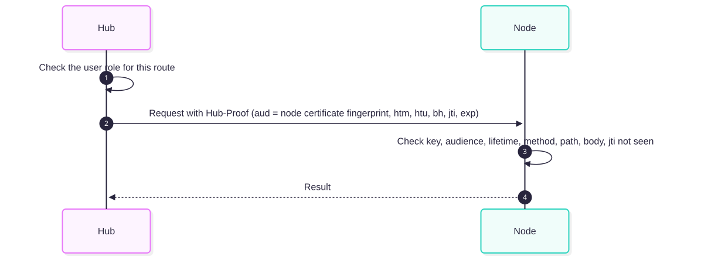

# Security

Read this page before you expose the hub. A `write` or `admin` login can run Claude Code, and so any command, as the run-as user on the hub and on every node. A `read` login cannot start anything.

## What a login gives

The launcher usually runs as root, because it writes unit files to `/etc/systemd/system`. So a `write` login gives command execution as the configured `instance.service_user` on every host. Only an `admin` can start an instance as a user other than `instance.service_user`. The default `instance.service_user` is `root`. With that default, a `write` user already runs Claude as root. Set a non-root `instance.service_user` where you can. Read [Roles](authentication.md#roles).

## User security model

The identity provider proves who a person is. The hub decides what the person can do:

1. The IdP decides who can sign in. Bind the application to the intended users or groups.
2. One claim in the token sets the role: `read`, `write` or `admin`. The hub checks the role on every route of the web UI and of the CLI.
3. A browser session is a signed cookie. A CLI login is an ID token, checked on every request.
4. In `proxy-jwt` mode a proxy logs the user in. The hub still checks the signature of the JWT, and never trusts a plain header.

Read [Authentication](authentication.md) for the setup.

## Hub and node security model

The hub is the only component that talks to the IdP. A node trusts the hub and nothing else. The hub does not send a reusable credential to a node. It signs a proof for each request.

These are the rules:

- The hub has one Ed25519 key pair. It makes the key on its first start and keeps the private key in `<state_dir>/hub-key.pem` with mode 600.
- A node trusts the public key of the hub, in a `[[node_auth.hub_key]]` row of its configuration.
- Each request carries `Authorization: Hub-Proof <jwt>`. The proof is valid for 30 seconds. It is bound to one node, one method, one path and one body, and to the fingerprint of the node certificate.
- The node checks the signature, the certificate fingerprint, the method, the path, the body and the time. It rejects a proof that it saw before.
- The proof carries the user and the role that the hub acts for. The node writes both to its audit log.
- The hub pins the certificate of each node, and checks the host name against it. TLS between the hub and a node is mandatory.
- A node enforces its own `instance.roots`, whatever the hub asks.

The consequences:

- A server that receives a proof cannot use it at any other node.
- Only the hub private key can impersonate the hub to a node. Only the node private key can impersonate a node to the hub.
- The hub has no account at the IdP for the nodes. To cut the hub off from a node, remove the hub key from that node.
- Anyone who holds the hub private key can forge proofs for every node that trusts the key. This stays true until you replace the `hub_key` row on each node. Read [Rotating the hub key](multi-host.md#rotating-the-hub-key).

A shared secret is the weaker second method for a node. It is long-lived and symmetric, with no revocation and no audit. Use one secret for each node.

## SSH delegation

SSH delegation lets a session use an SSH key that the hub holds. Read [SSH delegation](ssh-delegation.md) for the setup. These are the security rules:

- The hub makes one Ed25519 key for each target. The private key never leaves the hub process. A node stores no key and no secret that opens one. The host `local` is an exception: read the limits below.
- The hub stores each key encrypted in `<state_dir>/ssh/keys.json` with mode 600. A passkey with the PRF extension or a passphrase unlocks it. A recovery code, which the hub does not keep, opens a second copy. A recovery with the code chooses a new unlock method, ends every active grant, and needs one re-lock for each target. Without the code, the only way is to delete the SSH folder and add the targets again.
- Only an `admin` can set up SSH access, add a target, approve a grant, unlock a key or revoke a grant. A `write` user can list the status, the targets and the grants. A `write` user can also turn on Allow SSH requests for an instance, because that is an instance option.
- Every grant needs a new unlock. The hub holds a key in memory only while a grant is active. A stolen login cannot approve a grant, because the approval needs the unlock too.
- A grant lasts 60 minutes by default and 480 minutes at most. A grant cannot be extended. A hub restart ends all grants.
- The hub pins the SSH host key of each target. A session cannot be sent to another machine.
- The line in `authorized_keys` limits the key to the source addresses of the allowed nodes. It also turns off forwarding. A Dropbear router is an exception. Read [The provisioner key](#the-provisioner-key).
- When a session asks for SSH access, the hub sends a push message to each stored device. The message holds the target id, the instance name, the minutes and the reason, cut to 120 characters. It never holds a key, a passphrase or a grant secret. A test grant sends nothing.
- Only an `admin` can register a device. A person who loses the admin role keeps getting messages. They cannot turn the switch off, because the route needs the admin role. When the push service drops the device, the messages end. To stop it at once, stop the hub, delete the file `<state_dir>/push/subscriptions.json`, and start the hub. A running hub writes the file again from its memory. The delete removes the devices of all users, so each admin must open the SSH page on each device.
- The hub keeps at most 20 devices for each user. The oldest device drops first. If an endpoint is registered again, it moves to the latest person.
- The hub writes one audit line for each step of a grant. A signature line holds the key fingerprint and never the signed data.

These limits remain:

- A grant gives the full power of the account on the target. A target cannot limit it to read-only.
- A root session on a node can use the socket of a grant while the grant is active.
- Sessions on the own host of the hub (the host `local`) run with the trust of the hub. During an active grant, a root session there can read the open key from the memory of the hub and read the unlock in transit. It can also read `keys.json` and `hub-key.pem`. If you allow requests from instances of `local`, you give up the "cannot copy the key" guarantee for root sessions there. On a separate node the guarantee holds.
- If an SSH connection is open when a grant ends, it keeps working.
- The instance name on a request is a claim of the node, not proof.
- The hub is a larger target, because it holds the keys. Keep `<state_dir>/ssh` in your backup, and protect it like `hub-key.pem`.

### The provisioner key

An external target can have a provisioner key. Read [The provisioner key](ssh-delegation.md#the-provisioner-key) for how it works. This section gives the threat model.

The hub stores the provisioner key like the main key. It has its own salt and its own sealed copy. One passkey tap or one passphrase opens one key only. The hub holds the provisioner key in memory only during a maintenance grant. The recovery code opens a recovery copy of it too.

A maintenance grant is a grant that runs one action with the provisioner key. These rules hold for it:

- It needs a new unlock of the provisioner key, from an `admin`. A stolen login cannot approve it.
- It lasts 1 minute and ends after its one run. The hub caps the signatures of the grant to the planned runs.
- A session can never create one, and it never opens the main key.
- It runs through the node `local`. The provisioner line allows the source address of `local` only.
- The approval sheet names the target, the action and the change before you unlock.
- Each step writes an audit line that starts with `audit ssh maintenance`. No line holds a key, a signature, an unlock or the full output of the script.
- The push message holds the target id and a short text. It holds no address and no key.

What a stolen provisioner key can do, when it is used from the source address of `local`:

- Switch the main line on and off. Off is a denial of service. On puts back a line that you approved earlier.
- Change the `from=` list of the main line. The list rule allows the wildcards `*` and `?`. So the command `sources *` lets the main key in from any address. The thief still needs the main private key to log in.
- Run `uninstall`. This removes both lines and is a denial of service.

It cannot add a key, read a file, open a terminal or forward a port. The flags `restrict` and `command=` stop that. The `from=` part stops a use from any other address.

The wildcard rule is a known limit. The hub uses the same rule for the node source addresses of the main line. A subnet or a CIDR range is not supported. Use only a source address that you trust, and do not enter a pattern that is wider than you need.

A root session on the host of the hub can use the socket of a maintenance grant for its one minute. This is the known limit of the host `local`. The session can then run any of the five commands. The short window and the audit lines limit the harm.

A bug in the script can expose the account, because the script runs as the account. These parts carry the risk:

- The parse of the command that the caller sends. The script uses `case` patterns and quoted variables only, and it never uses `eval`.
- The write of the key file. A wrong edit can drop other keys. A check counts the two known lines before each write, and tests check that other lines keep their bytes.
- A link attack. The script refuses a symbolic link at the folder, the key file and the state file.
- The script file itself. Anyone who can write it runs code as the account. Its folder has mode 700.

A job that rewrites `authorized_keys` removes the provisioner line too. The provisioner then stops working until you run the repair command with your own key. A dedicated account avoids this problem.

The field `detail` of a failed maintenance grant holds one line of text from the target. A hostile target controls that text. A `write` user can list grants, so a hostile target can show that user one line of text. The page shows it as plain text.

The hub is a larger target, because it holds two keys for each external target. Both are encrypted at rest. Keep `<state_dir>/ssh` in your backup, and protect it like `hub-key.pem`.

#### The router

Dropbear has no `from=` flag, so no key line on a router has one. This holds for the main line and for the provisioner line. The router does not limit the main key or the provisioner key by address.

- The approval of each grant is the only control for the main key on a router. A stolen main key logs in from any address, until you retire the target.
- The provisioner script checks the client address itself. It reads `SSH_CONNECTION`, which Dropbear sets. A client cannot change it, because Dropbear ignores the environment request of a client. The manual test checks this on a real router.
- The script check does not help against a thief who runs from the host `local`.

The router version is not yet tested on a real router. Read [Manual test of the router version](ssh-delegation.md#manual-test-of-the-router-version).

## All security notes

- The launcher typically runs as **root** (it must write unit files to `/etc/systemd/system`).
  A successful login therefore gives **root-level command execution** as the configured
  `instance.service_user` (Claude running in any directory under `instance.roots`).
- **Access control is the OIDC provider's, plus roles.** The provider decides who can sign in. A role claim in the
  login token decides what a person can do: `read`, `write`, or `admin`. See [Roles](authentication.md#roles). Only an `admin` is
  root-equivalent on every host. A user with no role claim gets `user_auth.default_role`, which is `read` by
  default. The optional `user_auth.allowed_users` list adds a second check for a provider that cannot limit who
  signs in. Bind the application in your provider to the intended users or groups.
- Prefer a dedicated non-root `instance.service_user` where possible, and keep `instance.roots` narrow.
- Sessions are stateless signed cookies valid for 12 hours. Logout clears the cookie but cannot
  revoke a copy of it; replace `session.secret` to invalidate all sessions.
- `user_auth.oidc.issuer` must be **https**. The ID token is not signature-verified on the token-endpoint
  response (it relies on TLS), so with an `http://` issuer a network attacker could forge a login.
  `http://` is accepted only for loopback hosts (`localhost`, `127.0.0.1`, `::1`) or when you
  explicitly set `user_auth.oidc.allow_insecure = true` (not for production); a startup warning is logged.
- Folders created from the UI are `chown`ed to `instance.service_user` when the launcher runs as root and
  that user is not root (uid/gid resolved once at startup with `id -u`/`id -g`; startup fails if
  the user does not exist), so the instance can write to them.
- Path-prefix mounting (e.g. `https://host/rc/`) is not supported; serve at a hostname root.
- **Cloning:** the hub never stores, sees or forwards a GitHub token. A `gh` login stores a long-lived token
  (the `repo` scope by default) for that OS user on that machine. Anyone with root-equivalent access to that machine
  can use it. The launcher login is already root-equivalent, so it can use it too. The launcher shows the one-time
  login code once. It does not log it or write it to disk.
- A clone runs `git` as the run-as user. `git clone` does not copy git hooks or `.git/config` from the repo. The risk is
  in the project files. Claude Code reads files such as `.claude/settings.json` (which can define hooks) and `CLAUDE.md`
  in a trusted folder. The node trusts the new folder after a successful clone, so Claude Code reads those files
  without asking. Clone only repos that you trust.
- The clone passes the credential helper for that one command (`-c credential.helper=!gh auth git-credential`).
  It does not write the helper into the repo.
- **Multi-host:** a hub login is root-equivalent execution on the hub **and on every node** (as each
  node's `instance.service_user`). Compromising the hub gives an attacker everything the hub can reach:
  the hub private key, any shared secrets and every pinned node.
- Nodes enforce their own `instance.roots` regardless of what the hub asks.
- The hub does not send a reusable credential to a managed node. It signs a proof for each request. The
  proof is valid for 30 seconds, for one node, one method, one path and one body. A server that receives
  a proof cannot use it at any other node.
- To cut the hub off from a node, remove the hub key from that node. The identity provider no longer
  provides a kill switch for the hub, because the hub has no account there for nodes.
- Anyone who holds the hub private key can forge valid proofs for every node that trusts the matching public
  key. This stays true until each node's `hub_key` row is replaced.
- Shared-secret node auth is weaker: long-lived and symmetric, with no revocation or audit. Use one
  secret per node. A stolen hub configuration exposes all of them.
- A node can only be impersonated to the hub with its private key (the hub pins the node's certificate).
  The hub can only be impersonated to a node with the hub private key.
- TLS is mandatory between the hub and the nodes. It hides the proofs and the traffic from the network.
- **Command-line client:** a CLI login gives the same access as a browser login, which is root-equivalent
  execution on the hub and every node. The CLI keeps a refresh token in `credentials.json` (mode 600) on the
  user's machine. Revoke it at the identity provider to end that login. The hub cannot revoke it.
- `host add` makes the hub open a connection to any address that the user names, and send it a
  signed proof after the user confirms the certificate fingerprint. The proof is bound to the confirmed
  certificate, so the receiving server cannot replay it at another node. The user already has full control through the
  hub, so this adds no new level of access, but it is a new way to make the hub connect somewhere.
- There is no unauthenticated mode. Only `/healthz` and `GET /cli/config` (two public values) are open.
