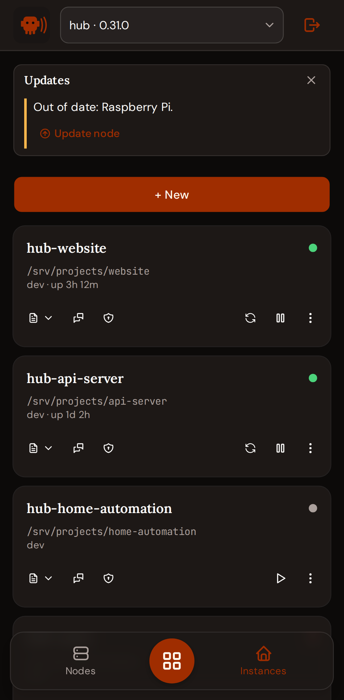
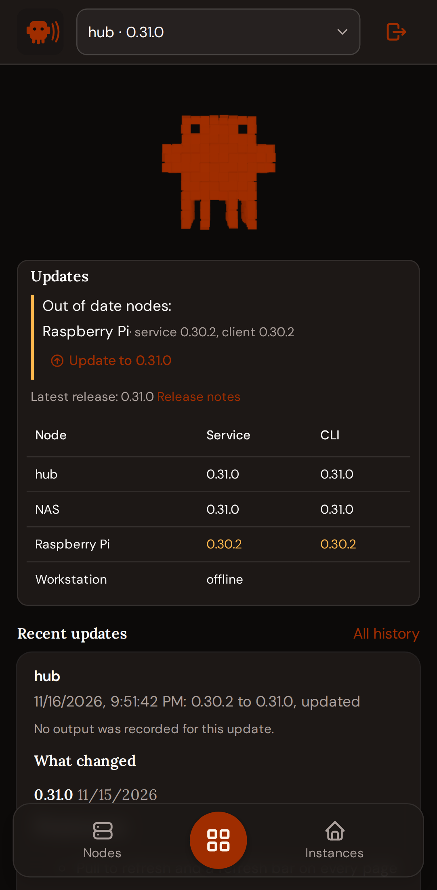

# Updates

The hub checks GitHub for new releases. It can update itself, every node, and the `claude-rc` client on each machine. You start an update from the web UI or from the CLI. Nothing updates by itself.

| Where | What |
|---|---|
| Web UI, Updates page | Update the hub, update all nodes, or update one node. |
| Web UI, Nodes page | Update one node. |
| `claude-rc update --all-nodes` | Update every node, then the hub, then this client. Read [Update every machine with one command](cli.md#update-every-machine-with-one-command). |
| `claude-rc update --node <id>[,<id>...]` | Update only the named nodes. Read [Update every machine with one command](cli.md#update-every-machine-with-one-command). |
| `claude-rc node update` | Run on a node: update its server binary. |
| `claude-rc update` | Update this client. |

An update through the hub (the web UI, `claude-rc update --all-nodes` and `claude-rc update --node`) needs the `admin` role. `claude-rc update` and `claude-rc node update` need no login, because they change only the machine where they run.

When a machine is out of date, a banner on every page of the web UI says so.

 

## Test builds

A test build is an unreviewed build of a branch. It is not a release. Its version is the next release number with a
suffix, for example `0.33.1-test.ssh.5bf4ca1`. The suffix has the word `test`, the branch name with dots in place of
other characters, and the short commit.

A test build never counts as the latest release. The hub ignores it when it looks for the latest release, and the
release notes never list it. The hub compares a test build by the release it is based on, as for a local build. The
suffix does not count. A machine that runs a test build is never stale only because the suffix differs from the latest
release. The hub never offers a test build as the target of an update. The banner never offers an older release to a
machine that runs a test build. A hub that runs a test build gives its nodes no update target, because the base release
can be unpublished. Update the nodes with `claude-rc update --node <id> --release <tag>`.

To put a test build on a node, run one of these commands:

```sh
claude-rc update --node <id> --release v0.33.1-test.ssh.5bf4ca1
claude-rc node update --release v0.33.1-test.ssh.5bf4ca1
```

The first command runs on any machine with a login and needs the `admin` role. The second runs on the node itself. To
leave a test build, update the node to a release with the same commands.

The web UI shows a test build as `0.33.1 (test build)`.

## Version check and updates in the web UI

The web UI shows the service and client versions of the hub above the New button. The Nodes page shows the versions
of each node. A stale machine carries a mark. A banner at the top of the page offers updates. The page checks when it
loads and when you return to the tab after more than five minutes.

A machine is stale in these cases:

- The hub is older than the latest GitHub release. This applies to the service and to the client.
- A node is older than the hub. This applies to the service and to the client.
- A local build such as `0.8.3+branch.sha` is compared by the release it is based on (`0.8.3`). The `+branch.sha` part does not count. The page shows the raw version, for example `0.8.3+branch.sha`.
- A test build such as `0.33.1-test.ssh.5bf4ca1` is compared by the release it is based on (`0.33.1`). Read [Test builds](#test-builds).
- A version of `dev` has no release. It is never stale.
- If a machine has two client copies, the older copy decides.

The banner has two separate buttons. `Update hub` updates the hub to the latest release. `Update all nodes` updates the
nodes to the version of the hub. The card of each node on the Nodes page also has an `Update` button. The UI never
updates anything by itself.

While an update runs, the Nodes page and the banner show its step as text. The steps are `downloading`, `verifying`,
`installing-client`, `installing`, `restarting`, `failed` and `up-to-date`. A client step adds the path of the client,
for example `installing-client: /usr/local/bin/claude-rc`. The step `failed` shows in the error color. Below the step
is an output panel with the lines of output of the update, newest at the bottom. The panel follows new lines while you
are at the bottom. It is open while the update runs. A finished update shows its panel closed. A page that opens late
gets the lines that the hub already holds. The hub keeps the last 200 lines of each machine in memory only, so a hub
restart clears them.

A node that stops during its update has the status `restarting`. The Nodes page shows `restarting`, and the node
stays in the Nodes menu with the status in its text. After 90 seconds without an answer, the status becomes `offline`. When the node
answers again, the status returns to `ok`. A node that drops its connection without a `restarting` step is `offline`
at once. The hub learns about these changes from an event stream that it holds open to each node, so the page does not
wait for the next poll. The hub logs one line when the status or the reason of a node changes, and none for a repeat.

A machine shows its client in one of four ways:

- The version, for example `0.8.4`, when the node found a client.
- `client 0.8.4+branch.sha`, when the client is a local build. It is compared by the release it is based on. A client of version `dev` shows as `client dev` and is never marked stale.
- `no client`, when the node looked and found none.
- `client not reported`, when the node is too old to report clients or the answer is missing.

A node finds its clients through a client registry. On Linux it is a file that lists each installed client on one line:

```
client <absolute path>
```

The file is `/etc/claude-rc-launcher/installs`. The node reads it only if root owns it and neither the group nor others can
write it. The node applies the same check to the folder. A client entry also needs its real file and folder owned by root,
with no group or other write access. Otherwise the node skips that entry and logs a line. `install-cli.sh` writes the line
when it runs as root or through `sudo`.

On Windows the registry is the value `Client` (a `REG_SZ`) under `HKLM\SOFTWARE\claude-rc`. It holds the full path of
`claude-rc.exe`. `install.ps1`, the elevated installer, writes it. By default only administrators can write under
`HKLM\SOFTWARE`, so the node does not check the key. A missing key is normal and gives no log line. The node ignores a
value that is not a local path to a file named `claude-rc.exe`.

The node also always scans for clients. On Linux, it scans the `PATH` and the `~/.local/bin` folders of the service user
and of root. On Windows, it scans the `PATH` (split on `;`) and two default places under `%ProgramFiles%`:
`claude-rc\bin\claude-rc.exe` and the older `claude-rc\claude-rc.exe`. Registered entries come first, and each real file
appears once. Only the scan finds a client installed without administrator rights.

The hub restarts while it updates, and the page reconnects by itself.

The hub asks GitHub for the latest release and keeps the answer for five minutes. The browser never calls GitHub. If GitHub
does not answer, the page shows `latest unknown` and offers no hub update.

The hub keeps the last update of each machine in `<state_dir>/updates.json`. The status is `running`, `updated`,
`up-to-date`, `failed`, `rolled back` or `unknown`. Every browser sees the same record.

If the hub runs another version than the one that served the page, the page reloads itself. If the "New" dialog is
open, the page shows a "Reload" bar instead. While a machine updates or restarts, the "New" dialog asks you to tick
"Start anyway" before it starts a session or a clone. The update of a Windows node restarts its sessions, and the banner
says so. The update replaces the two binaries and nothing else. The service definition (the WinSW XML and the launcher
script) is written once by `install.ps1`. The XML carries a version marker, and a node reports it in `GET /api/node`.
If a release needs a newer definition, the banner tells you to run `install.ps1` again on that node. A definition
without a marker counts as version 1. A node reports its platform in `GET /api/node`, so an old node shows no such note until it is updated.

The hub also keeps the last 20 finished updates of each machine, with their output lines, in
`<state_dir>/update-history.json`. The page shows them in the "History" section. The hub update has no output lines,
because the old process ends before the new process settles the record. The route is `GET /api/updates/history`.

The hub writes the story of each update to its journal. The lines start with `[update]`. Lines about the event streams
start with `[events]`. The page writes its own lines to the browser console with the prefix `[claude-rc]`. While an
update runs, the page reads the update record again every 3 seconds. After the event stream reconnects, the page reads
the record and the host list again.

Keep these limits in mind:

- A user-scope service answers 409. A Linux machine whose service is not the installed one answers 409 too. The banner
  shows the message. A Windows node updates like any other node.
- A successful update shows no success message. The banner item disappears and the version text changes.
- The watchdog can roll back a new hub binary that starts and then fails within its first 30 seconds. The record may
  still say `updated` until the next update.
- A node that is too old to have the update route needs `claude-rc node update` once.
- Update the nodes first, then the hub. A node without the event route shows as `error (bad response)` until you
  update it. `claude-rc update --all-nodes` already uses this order.
- An older node does not report clients, so it shows `client not reported` until you update it.
- Before this release, a Windows node looked for its client with Linux rules and reported none. After you update it, its
  client version shows.
- Some releases change how the hub talks to the nodes. After such a release, the hub can lose the nodes. Roll such a
  release out by hand.
- An update needs the `admin` role.
