# Using the web UI

The web UI is the main way to use Claude RC Launcher. It is made for a phone screen, and it also works in a desktop browser. This page explains each screen.

An instance is one `claude remote-control` server that runs in one folder on one host. You open its sessions in the Claude app or on claude.ai. The launcher starts, stops and watches the server. It does not show the chat.

The screenshots use the dark mode of the Claude theme.

## Layout

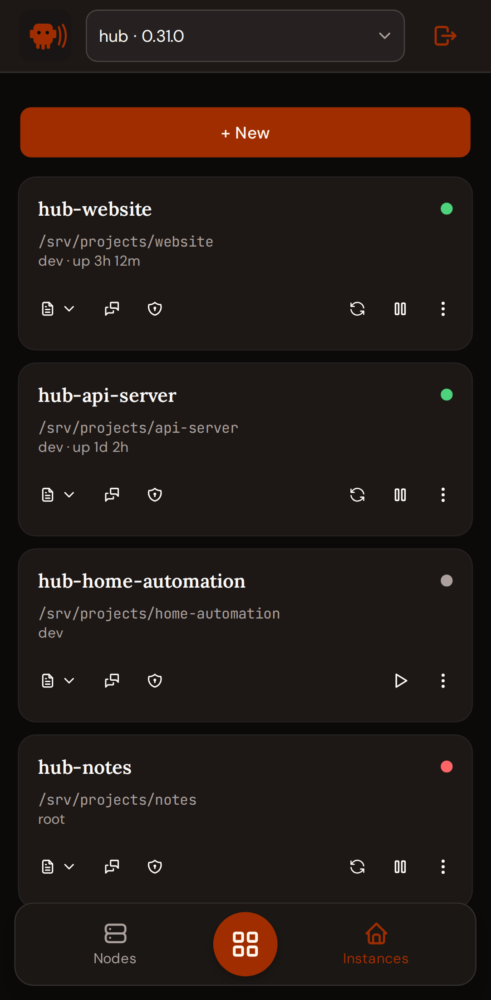

The header has two parts:

- The logo. Tap it to go back to the session list.
- The account menu. It shows your name and the Log out entry.

On a phone (480 px wide or less) the header is hidden to give the lists more room. The bottom bar has Sessions, and the menu sheet shows your name and has Log out. The thin line that shows a refresh moves to the top edge of the screen.

The bar at the bottom has three buttons: Sessions, the Menu button in the middle, and Instances. The menu opens a sheet with these entries: Sessions, Instances, Nodes, Updates, Appearance, SSH access (for an admin only), a link to the GitHub repository, and Log out with your name.

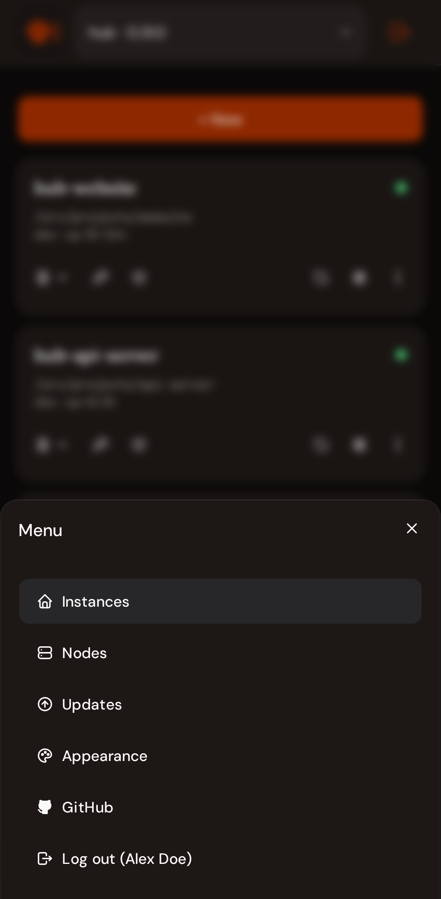

To load the data again, pull the page down. The page does not reload. It asks the hub again for the data on the screen. A thin line under the header shows that a refresh runs.

You can install the page as an app (a PWA, a web page that runs like an app). In the browser menu of your phone, choose "Add to Home screen" or "Install app".

What you see depends on your role. A `read` user sees the lists, logs and files, but no buttons that change something. Read [Roles](authentication.md#roles).

## Sessions and the node filter

The Sessions view is the first page. It lists the sessions of every instance on every host. Running sessions come first (busy before idle), and the other sessions follow, newest first. Each row shows the name of the session, its state, the host and the instance, and the details.

If you have more than one host, a Nodes button shows above the list on the Sessions view and on the Instances view. It says "Nodes: all", the name of the one selected host, or a count such as "Nodes: 2 of 5". A tap opens a menu with a checkbox for each host. The menu stays open while you tick hosts, and it scrolls if the list is long. "All nodes" clears the selection. With no host ticked, the views show all hosts. The tab keeps the selection, and both views use it. Each host has a status dot: green for ok, yellow for restarting, and red for a host that does not answer. Such a host stays in the menu.

The Sessions page does not poll. When it opens, it opens a sessions stream (a server-sent event stream) to the hub. The stream sends the stored lists at once, and then each change as it happens. A session that starts, ends or turns busy shows up within seconds. A pull to refresh reads the list from the hub again. A return to the tab does not, because the stream keeps the data.

If a host gives no rows, a note above the list names it. This way a missing host is not mistaken for "no sessions". The note says:

- "not answering" for an offline host.
- The error text for a host with an error.
- "no session files on this node" for a host that cannot list sessions.
- "loading" for a host that has not sent its first list yet.

A tab that is not visible drops its streams. If the tab stays hidden for 30 seconds, the app closes them. A quick switch to another tab does not close them. When the tab is visible again, the app opens the streams again, and each new stream starts with a full list. The rule follows the visibility of the tab, not the focus of the window. A window that you can see next to another one keeps its streams. Read [Sessions and files](#sessions-and-files) for what you can do with one session.

## Instances

The Instances view has two modes. From the bottom bar it is global: the title is "Instances", the node filter shows, and the view lists the instances of the selected hosts. If more than one host shows, each host has a heading below the title. From the Nodes page it shows one host: the title is "Instances on <host>", there is no node filter, and "+ New" starts on that host. If you have more than one host, the New dialog starts with a Node field. If exactly one host is ticked, or you opened one host from the Nodes page, the dialog starts on that host. Each card shows:

- The name of the instance. This is the `--name` that the Claude app shows.
- The folder.
- The run-as user, and the time since the start.
- A status dot. Green is running, gray is paused, and red is failed.

The row of buttons on each card:

| Button | What it does |
|---|---|
| Logs | Opens the last lines of the journal of the instance under the card. |
| Sessions | Opens the [sessions](#sessions-and-files) of the instance. |
| Permissions | Opens the [permission rules](#permissions) of the user of the instance. |
| Restart | Stops and starts the server. The button asks you first. |
| Pause | Stops the server and keeps the instance. A paused instance does not start after a reboot. |
| Resume | Starts a paused instance again. |
| More (three dots) | Opens the menu with Settings and Stop. |

Stop removes the instance. On Linux, the node runs `disable --now` and deletes the unit file. The instance does not come back after a reboot. Stop asks you first. Stop does not delete the folder or the sessions.

A Windows node has no pause. Its instances run while the node service runs.

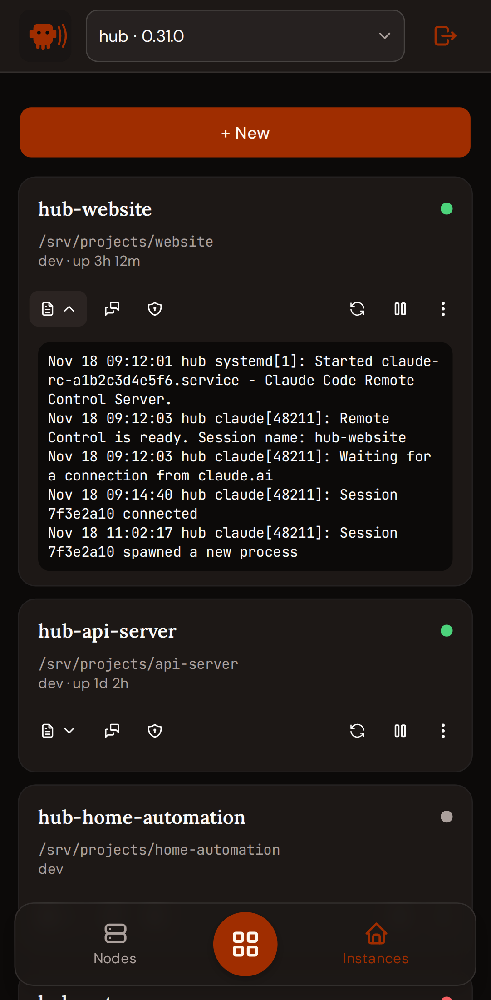 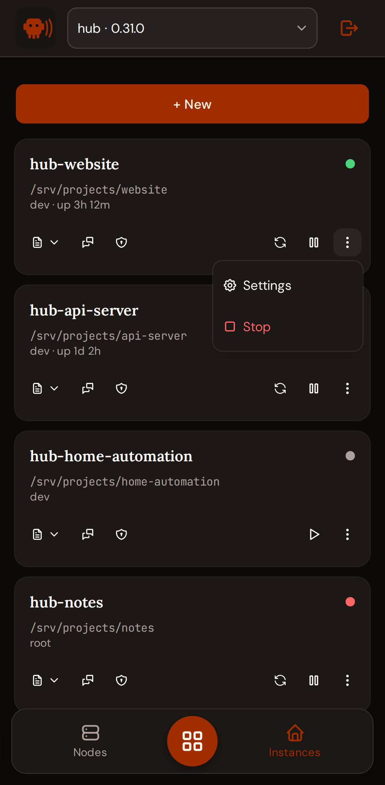

On a wide screen the buttons also show their names.

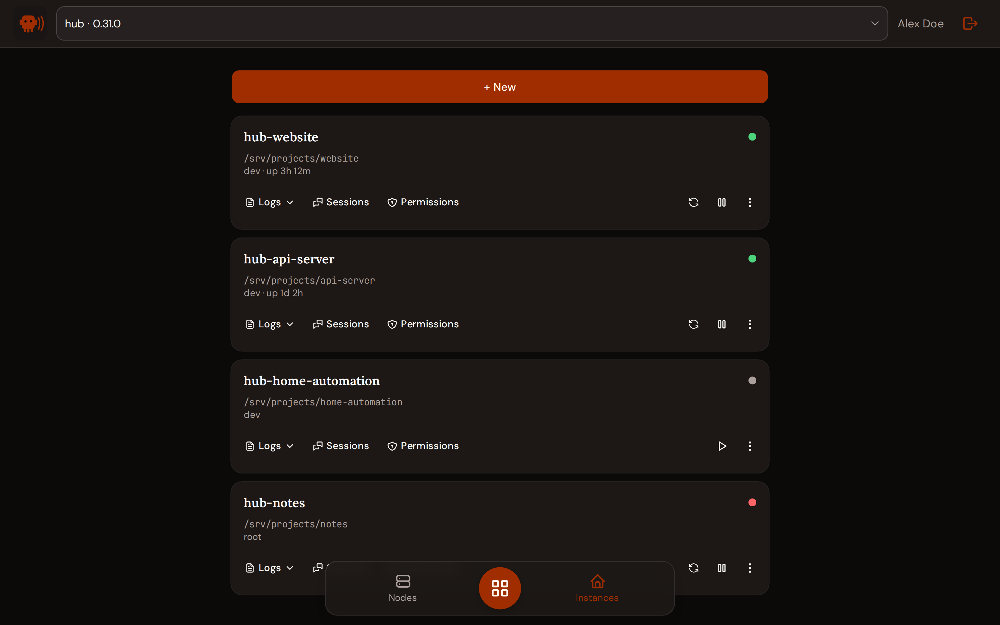

## Start an instance

Tap "+ New". The "New instance" dialog opens.

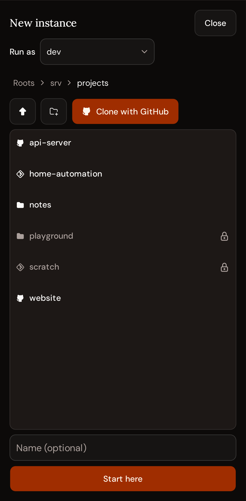

1. If the host runs as root in system scope, choose the run-as user in "Run as". Otherwise the selector is hidden.
2. Go to the folder. Tap a folder to open it. The path at the top takes you back. The up arrow opens the parent folder.
3. To make a new folder, tap the folder button with the plus sign and type a name.
4. Optionally, type a name for the instance. The default name is `instance.name_prefix` of the host, followed by the folder name.
5. Tap "Start here".

The icon before each folder tells you what it is: a plain folder, a git repository with no GitHub remote, or a GitHub repository. A gray folder with a lock is not trusted by Claude Code for the selected user. You can still select it. The dialog then asks you before it adds the folder to the trust list. Read [Trusted folders and the run-as user](configuration.md#trusted-folders-and-the-run-as-user).

The dialog also has the settings of the instance. Read [Instance settings](#instance-settings).

One folder has one instance, whatever the user. A second start in the same folder fails and names the user of the first instance.

## Clone a GitHub repository

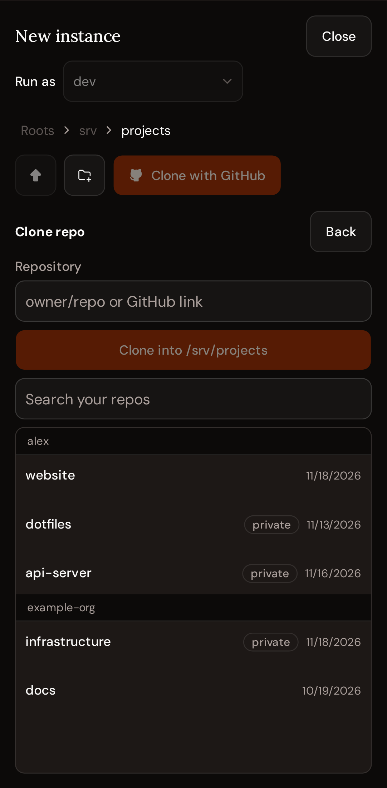

You can clone a GitHub repo into a folder on a host and start an instance in it. The host must be a Linux host.
Windows nodes do not support clone in this version.

### In the web UI

1. Choose "+ New". The "New instance" dialog opens. Open the folder where the repo must go.
2. Choose the blue "Clone with GitHub" button. For a host that cannot clone, the button is hidden. At the roots level
   the button is disabled, because the clone needs a parent folder.
3. Paste a link or `owner/repo`, or pick a repo from the searchable list. The list is grouped by owner.
4. The UI clones the repo, opens the new folder and starts the instance there. While the clone runs, the dialog
   locks its Close button.

After a successful clone, the node adds the new folder to the trust list of the run-as user. The instance then starts
without the trust question. Because of this, Claude Code reads project files such as `.claude/settings.json` hooks and
`CLAUDE.md` in the cloned repo without asking, so clone only repos that you trust.

If the list needs a GitHub login, the panel shows "Sign in to GitHub". The panel then shows a short code and a link.
Open the link on github.com and enter the code. A pasted link works without a login for a public repo.

### On the command line

```sh
claude-rc clone <repo> <parent> [--user <u>] [--name <n>] [--force]   # clone, then start, then print the instance id
claude-rc repos [--user <u>]                                          # your GitHub repos, grouped by owner
claude-rc gh-login [--user <u>]                                       # sign in to GitHub on the node
```

All three accept `--host <id>`. `clone` clones into a new folder in `<parent>` and then starts an instance in it.
`--name`, `--user` and `--force` work as they do for `start`. If the start fails, the CLI prints the path of the cloned folder.

- If no GitHub login exists, `repos` stops with `GitHub login required. Run "claude-rc gh-login"`.
- `gh-login` prints `Open <url> and enter the code <code>`, waits, and prints `signed in`.
- If the node is too old to clone, or is a Windows node, the CLI stops with `this host cannot clone. Update the node.`

The repo argument can be any of these:

- A `github.com` link, with or without `.git`, with a trailing slash, with extra path parts or with a query.
- `owner/repo`.

The node rejects other hosts, SSH addresses and links with embedded credentials. It also rejects `http://` links and
`www.github.com` links. Use `https://github.com/...` or `owner/repo`.

### How it works

- The node that owns the folder runs the clone. It runs `git` as the run-as user of the instance.
- The clone goes into a new subfolder. The folder is named after the repo and sits inside the folder you view.
- The node enforces its own `instance.roots`. The subfolder must not exist yet.
- The clone is a background job. The request returns at once, and the client polls for the result.
- A clone that runs longer than 10 minutes fails.
- If a clone fails, the node removes the folder that it created.
- If a clone succeeds, the node adds the new folder to the trust list of the run-as user before the job reports `done`.
  If that step fails, the clone still succeeds. The start then asks the usual trust question.
- The trust entry stays in the `~/.claude.json` of the user after you delete the folder. A later folder with the same
  path inherits it.
- A node older than this release still shows the trust question after a clone.
- The `origin` remote is the plain address `https://github.com/<owner>/<repo>.git`.

### Requirements on each machine

- `git` and `gh` must be on the `PATH` of the instance user. The node does not use its own environment.
  It runs both with `HOME` set to the home of that user and with a fixed `PATH`.
  For the configured `service_user`, the `PATH` is `instance.service_path`. Its default is
  `<service_home>/.local/bin:/usr/local/sbin:/usr/local/bin:/usr/sbin:/usr/bin:/sbin:/bin`.
  For another user, the `PATH` is `<home of that user>/.local/bin:/usr/local/sbin:/usr/local/bin:/usr/sbin:/usr/bin:/sbin:/bin`.
- If the clone runs as a different user from the launcher, `setpriv` (from util-linux) must be installed.
  If the launcher runs as root with a non-root `service_user`, the clone runs as that user. Then it needs `setpriv` too.
- Private repos and the repo list need a GitHub login for that user. A public repo needs no login.

You can log in in one of two ways. Run `gh auth login` on the machine as that user. Or use the launcher: the web
"Sign in to GitHub" button or `claude-rc gh-login`. The launcher runs `gh auth login --web`, a device login where you
enter a short code on github.com. It then runs `gh auth setup-git`, so that a later `git push` works.
`gh auth setup-git` edits the global git configuration of that user.

If `gh` keeps its token in a desktop keyring, the node cannot read the token. The reason is that `setpriv` starts
`gh` with no D-Bus session. The repo list then asks for a login. The login from the launcher writes the token to
`hosts.yml` in the `gh` configuration folder of that user. After that login, the repo list works.

### Limits

- Only the first clone exists. There is no pull, no branch switch and no delete.
- Only `github.com` works.
- A host in user scope runs the clone as the service user only.
- The repo list does not show repos where you are only an outside collaborator. You can still clone them by link.
- Windows nodes do not support clone. They answer 404 on the clone routes, so the web UI hides the button.
- While a clone runs, the node refuses to start an instance in that folder or below it. The answer is 409
  `a clone is still running in that folder`.
- If the node restarts during a clone, the client reports that it lost track of the clone. The partial folder stays on
  disk. Remove that folder before you clone the repo again.

## Instance settings

Open the More menu of a card and choose Settings.

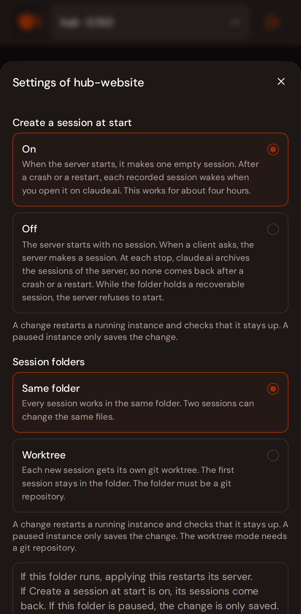

Three settings control the server. Two control how it starts:

- "Create a session at start" (`createSession`). On is the default. The server makes one empty session at start, and it brings back its recorded sessions after a crash or a restart. Off starts the server with no session.
- "Session folders" (`spawnMode`). "Same folder" is the default: every session works in the same folder, so two sessions can change the same files. "Worktree" gives each new session its own git worktree (a separate checkout of the same repository). The folder must be a git repository.

A third setting, "Allow SSH requests" (`sshRequests`), is off by default. When it is on, a session of the instance can ask for SSH access with `claude-rc ssh request`. A Windows node offers it only when the node has a working OpenSSH client. Read [SSH delegation](ssh-delegation.md).

Press Apply to save the change. If the instance runs, the change restarts its server. If the server does not stay up with the new settings, the node puts the old settings back and the dialog shows the reason. If the instance is paused, the change is only saved. It starts at the next resume.

The CLI page has the full rules: [Instance settings](cli.md#instance-settings).

## Recover sessions after a crash

If a server starts without `--no-create-session-in-dir`, its sessions survive a stop. This holds for a crash, an out-of-memory kill and a restart. When the server starts again, it runs one session. The other sessions have no process yet. When you open one of them on claude.ai, the server starts a process for it. This works for about four hours after the server stopped. The four hours come from the Claude Code documentation. The launcher does not test them.

To restart a server, press Restart on the instance card. The button asks you first. A paused instance has no Restart button, so resume it first. Open the session on claude.ai after the restart.

If the setting "Create a session at start" is off, the unit has `--no-create-session-in-dir`. In that case claude.ai archives the sessions at each stop, and none of them comes back. A server with that flag also refuses to start while its folder holds a recoverable session. To recover sessions, turn the setting on in the settings of the instance. The change restarts the instance.

## Sessions and files

Open Sessions in the bottom bar. The page lists the sessions that Claude Code recorded for the folders of all instances. Tap Sessions on an instance card to see only the sessions of that instance. This list reads that one node only, so another node that is down does not slow it. The heading then reads, for example, "Sessions: blog on hub", and the node filter and the node and instance on each row are left out.

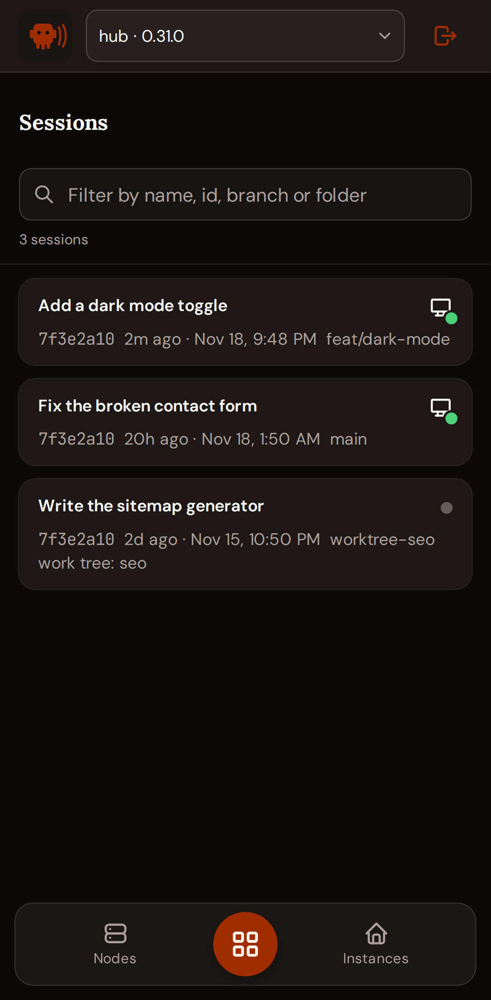

- The filter box finds a session by name, id, branch or folder.
- A session that runs now has a green dot on its icon. The desktop icon marks a Remote Control session.
- A session in a git worktree shows "work tree" and the name of the worktree.
- The line under the name shows the short id, the last activity, the start time and the branch.

The name is the name that the Claude app shows. The node remembers the best name of each session, so a name survives a compact (a summary of the conversation that replaces it).

Open a session to see two tabs: Files and Permissions. The Files tab has three views.

| View | What it lists |
|---|---|
| Touched | Files that Claude wrote or edited with its file tools in this session. |
| Changed | Files that git shows as changed in the folder since the session started. This includes files that commands made. Git cannot tell who changed a file, so changes by you or by another session in the folder are listed too. |
| Folder | Every file in the folder of the session. "Show hidden" also lists files whose name starts with a dot. |

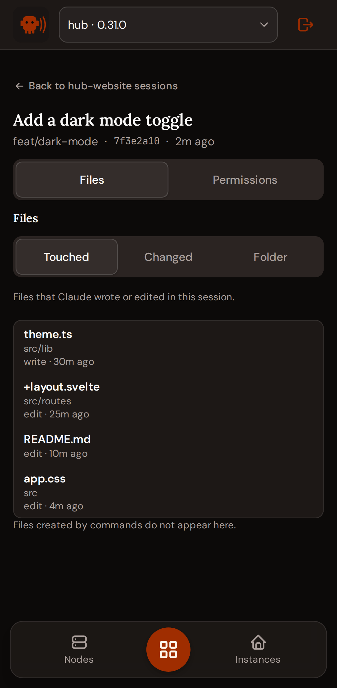 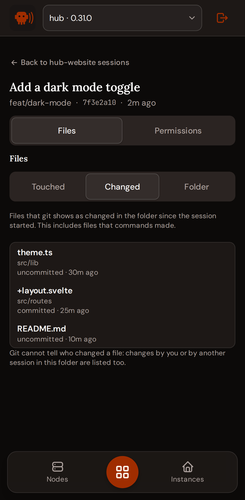 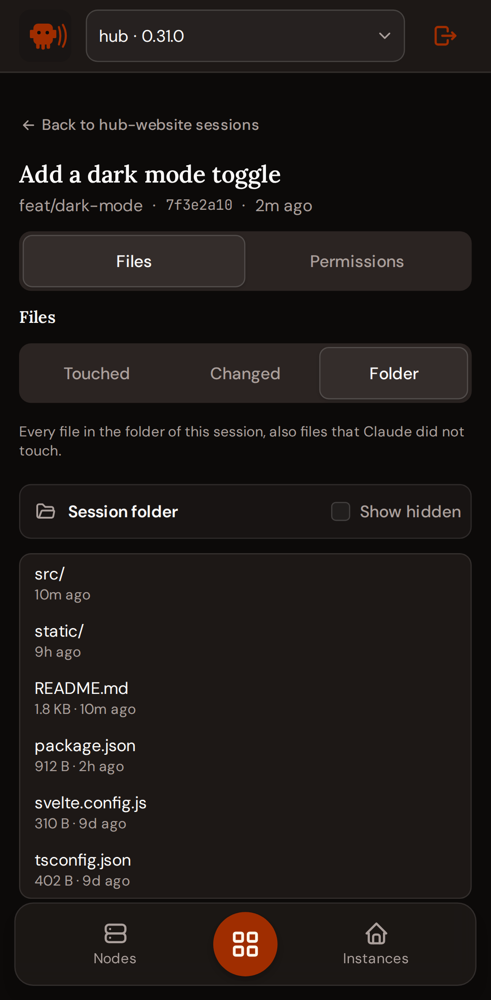

Tap a file to open a preview. A markdown file shows rendered, and the Source switch shows the text. A code file shows with colors, and the Wrap switch turns line wrapping on and off. Download gives the whole file.

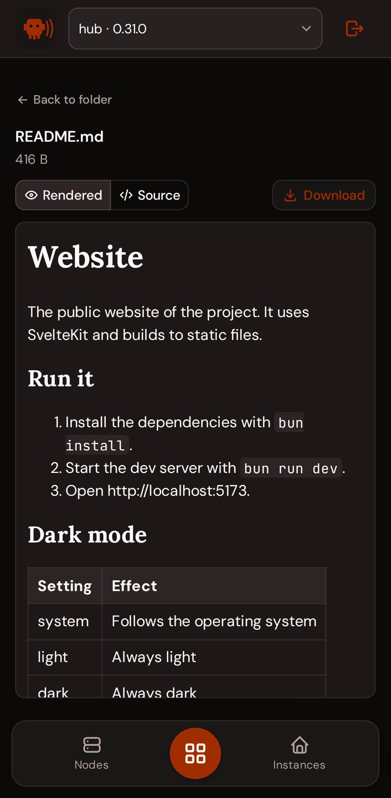 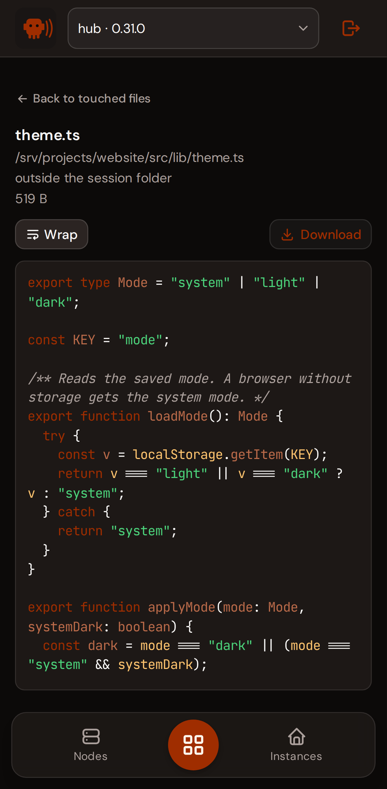

These are the rules for the files:

You can look at the files of a session from your phone. On an instance card, choose "Sessions". The page lists the
sessions of that instance. Open one to see two tabs. "Touched" lists the files that Claude changed. "Folder" lets
you browse the session folder.

The list shows every session that Claude Code recorded for the instance folder. It includes work-tree sessions that
Claude Code files under `.claude/worktrees`. It also includes sessions that you started yourself in that folder.
A session that runs now shows a "live" badge with its status ("busy" or "idle"). If it uses Remote Control, it also
shows a "Remote Control" badge. A running session shows the name that the Claude app shows.

"Touched" lists files that Claude wrote or edited with its file tools. A file counts only when the write succeeded.
If the call was denied, failed or got no answer, the list shows the file as "not written" and does not open it.
Files that a command created do not appear. Use the "Folder" tab to find those files.

- The node reads files as its own service account. It can read only what that account can read.
- The node serves files inside a session folder. On each request it finds the folder again from the transcript.
  The real place of that folder must be inside the instance folder. If a link leads it out, the node refuses it.
- A touched file outside the session folder can also be opened. The node serves it only if its path is exactly on
  that session's touched list and the write succeeded. It refuses any other file outside the folder. It also refuses
  the file if its name or its parent folder is a link. The touched list comes from the transcript, so anyone who can
  write the transcript can add a file to it.
- The node never serves a file outside the session folder that has more than one hard link.
- The node never serves a file outside the session folder under `/proc`, `/sys`, `/dev` or its own state folder.
  On Windows it serves a file outside the session folder only by a drive-letter path. It refuses a network path
  (`\\server\share`) and a device path (`\\?\` or `\\.\`), because opening a network path can send the
  credentials of the service account to that server.
- The node reads transcripts from `<home>/.claude/projects` of the instance user. Claude Code deletes old transcripts
  after its cleanup period, so an old session disappears from the list.
- A markdown file (`.md` or `.markdown`) shows rendered, with headings, lists, tables, code blocks, quotes, links and
  task lists. A Source switch shows the plain text with colors instead. A file in a known language shows with colors,
  and a Wrap switch turns line wrapping on and off. Any other text file shows as plain text.
- The colors cover TypeScript, JavaScript, JSON, Python, shell, YAML, HTML and XML (also Svelte and Vue), CSS, SQL,
  Go, Rust, INI and TOML, diff, Dockerfile and Makefile. The detail is in
  [How session files work](session-files.md#how-the-web-preview-formats-a-file).
- The preview renders markdown up to 64 K characters. K is 1,024, and the count is characters, not bytes. A larger
  markdown file shows as plain text with a note. If rendering fails, or a small file is too complex (very deep nesting or thousands of elements), the file shows as plain text with a note.
  Code has no size limit below the 512 KB cut. The code view builds only the lines on the screen. Plain text up to 8 K characters, with no line longer than 2,000 characters, shows in a simple box. Any other plain text shows in the code view.
- A markdown file cannot run code or load anything from another site. Raw HTML in the file shows as text. An image
  shows as a link with its alt text and never loads. Only links that start with `http://`, `https://` or `mailto:`
  stay, and they open in a new tab. Code never goes through HTML.
- The libraries for markdown and colors load only when a preview opens.
- A text file shows its first 512 KB. A Download button gives the whole file. Any other file is a download.
- A download is a stream. The hub passes the bytes on and never holds a whole file in memory.

The preview has no editor, no line numbers, no search, no images, and no JSON or CSV views. A selection covers only
the lines that the view has built, so use Download to copy the whole file. Session files are not yet verified on
Windows nodes.

If a node has no session files, the web UI hides the "Sessions" button for its instances. The hub tells the web app this in the field `sessions` of the host list.

To learn how session files work inside the code, read [How session files work](session-files.md).

## Permissions

Claude Code asks for approval before it uses some tools. In a Remote Control session nobody is at the terminal, so a blocked call can stop the work until you answer in the app. The Permissions screens show the rules of Claude Code, show the calls that it blocked, and let you add a rule from your phone.

A permission rule has a list and a pattern. The lists are Allow, Ask and Deny. A pattern is a tool name with an optional specifier, for example `Bash(git status)` or `WebFetch(domain:github.com)`. The rules come from several settings files:

| File | Badge | Path |
|---|---|---|
| User | User | `~/.claude/settings.json` of the run-as user. It applies to every project of that user. |
| Project | Project | `.claude/settings.json` in the folder. It is usually in git. |
| Local | Local | `.claude/settings.local.json` in the folder. It is usually not in git. |
| Managed | Managed | The managed settings of the machine. The UI shows them and does not change them. |

A deny rule wins over an ask rule, and an ask rule wins over an allow rule, whatever the file.

### The Rules view

On a session, open Permissions, then Rules. The list shows every rule that applies to the session, in the order Deny, Ask, Allow. A badge names the file of each rule. The chips at the top filter by file. The X button removes a rule from its file. "Add rule" opens the rule sheet.

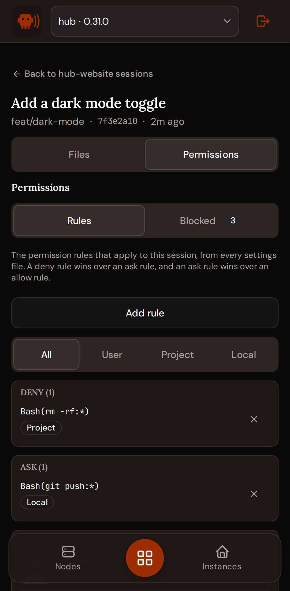 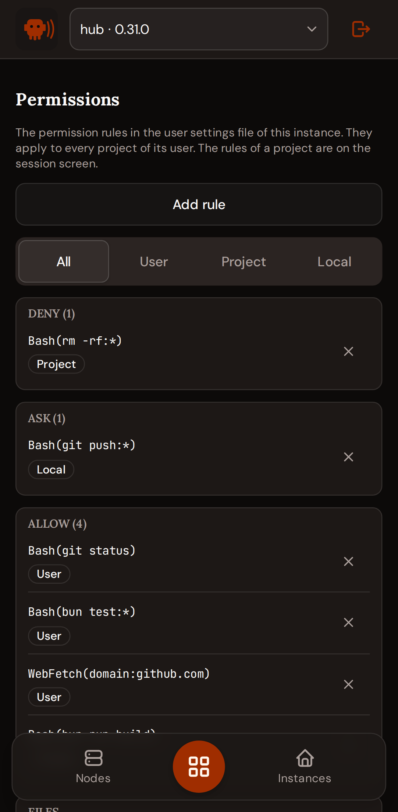

The Permissions button on an instance card opens the same list for the user settings file alone. Those rules apply to every project of the run-as user. The rules of a project are on the session screen.

### The Blocked view

On a session, open Permissions, then Blocked. The list shows the tool calls that Claude Code blocked in this session. Each row shows the command or the tool input, the tool, the time and the reason:

- "Needs approval": Claude Code asked for approval.
- "You said no": a person rejected the call.
- "Deny rule": a deny rule blocked the call. The row names the rule.
- A classifier or a safety check of Claude Code blocked the call.

"probably fixed" marks a call that a rule now allows. "Allow..." opens the rule sheet with a rule for that call.

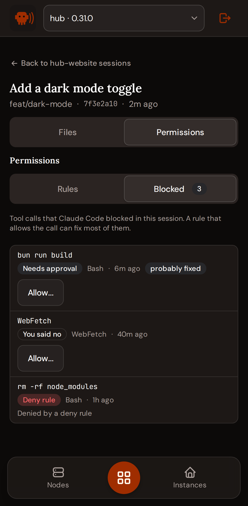 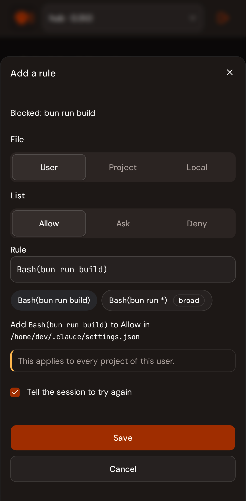

### The rule sheet

1. Choose the file: User, Project or Local.
2. Choose the list: Allow, Ask or Deny.
3. Type the rule, or tap a suggestion. A suggestion marked "broad" matches more than the blocked call.
4. Read the line that names the rule, the list and the file. If the rule applies to every project of the user, a warning tells you so.
5. If you want the session to continue at once, leave "Tell the session to try again" on.
6. Tap Save.

The node writes the rule into the JSON file. It keeps the indent, the key order and the other keys. It writes as the run-as user. If somebody changed the file after the page loaded it, the save fails with "The file changed. Reload." and nothing is written. Each change writes an audit line on the node and on the hub. A change needs the `write` role.

"Tell the session to try again" sends a short fixed message to the live session through its local socket. The message names the list and the file, and does not contain the rule text. It works only for an Allow rule, only for a session that runs now, and only on Linux nodes.

## Hosts and nodes

A host is a machine that runs instances. The hub is the host `local`. A node is another machine that the hub controls. Read [Multiple hosts](multi-host.md).

The Nodes button above the Sessions and Instances lists selects the hosts that the views show. An offline host stays in its menu with a red status dot.

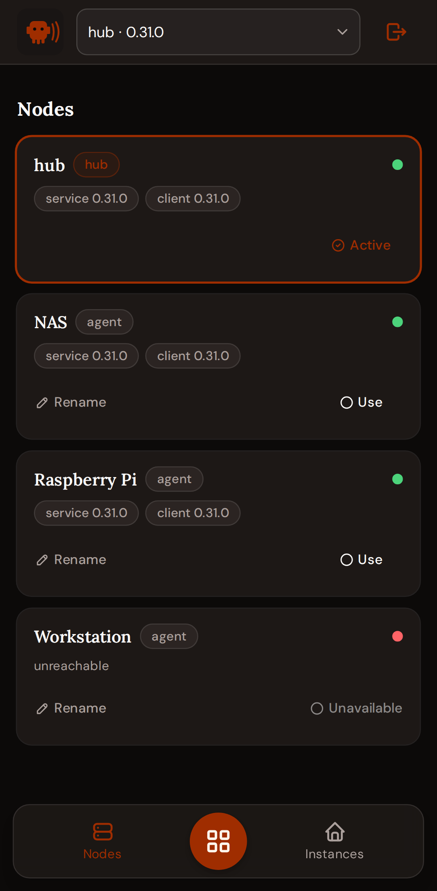

The Nodes page shows one card for each host:

- The badge "hub" or "agent" (a node).
- The versions of the service and of the `claude-rc` client on that machine. A yellow dot marks an old version.
- A status dot. If the host is offline, the card also shows the reason.
- Rename changes the display name. The id stays.
- Update updates that node. Read [Updates](updates.md).
- Show instances opens the Instances view for that host only. The title reads "Instances on <host>" and there is no node filter. The node filter of the other views does not change. A host that is not running shows a disabled Unavailable button.

## SSH access

An admin sees the entry SSH access in the menu. A badge on the entry counts the requests that wait for you. Read [SSH delegation](ssh-delegation.md) for the whole setup.

On the first visit, the page asks you to choose an unlock method, a passkey or a passphrase. It then shows the recovery code once. After the setup, the page groups its parts in sections that open and close. A tap on the header of a section opens or closes it. The browser remembers which sections you opened or closed. On the first visit, Access requests and Targets are open. Nodes and Settings are closed. The sections are, in this order:

- Access requests. Each request shows the target, the node, the instance and the time. A pending request has Approve and Deny buttons. An active grant has a Revoke button. The list refreshes every 5 seconds. The header shows a badge with the number of pending requests.
- Targets. Each target shows its state: `draft`, `ready` or `disabled`. The buttons are Continue setup, Disable, Enable, Edit nodes and Retire. Edit nodes needs the `admin` role. It lists the nodes with access turned on. After you press Save, an external target without a provisioner shows the new key line with a Copy button. Install it in place of the old line. A `dropbear` target is an exception: its line has no address limit, so the page says that the line stays the same. A managed target gets the new line from the hub. A target with a provisioner waits for your approval. Read [Provisioner key and maintenance](#provisioner-key-and-maintenance). A retire deletes the target. A notice then tells what happened to the key line on the machine.
  - Add target. This opens a wizard with these steps: the form, the key, the host key, the install and the test. The form has an optional Key file field for a managed target of the type `linux` or `synology`. For `linux`, an empty field gives `authorized_keys.claude-rc`. Type `authorized_keys` to use the main file. For `synology`, an empty field gives `authorized_keys`. On the Test step, the wizard can show a note about the sshd check. Read [SSH delegation](ssh-delegation.md#keys-that-a-job-overwrites).
- Nodes. A switch turns SSH access on for a node. Enter the source address that targets see when the node connects.
- Settings. It holds the switch Notify this device, the button Check my passkey and the recovery button, in this order.
  - Lost your passkey? Recover. This button starts a recovery with the recovery code. With a passphrase, the button is Forgot your passphrase? Recover. Read [SSH delegation](ssh-delegation.md#recover-with-the-recovery-code).

A section opens by itself when it needs you, also when you closed it before. A new pending request opens Access requests. A link to a target, for example from a notification or from the command line, opens Targets. When targets wait for a re-lock, a banner above the sections names how many. Its button opens the recovery flow.

The switch Notify this device is for admins. If you turn it on, the browser asks for permission to show notifications. The hub then sends a push message to this device for each new request. If you turn it off, the hub forgets the device. The switch is hidden if the browser cannot do push. If the permission is blocked, the page tells you to allow notifications for the site in the browser settings. Before the setup, the switch is above the setup form. Read [SSH delegation](ssh-delegation.md#notifications).

Approve opens a sheet. The sheet shows the node, the instance, the target, the account and a warning about the power of the account. The instance name is a claim of the session. Set the minutes, from 1 to 480, and unlock with your passkey or passphrase.

### Provisioner key and maintenance

A target with a provisioner key shows a badge `provisioner` on its card. Read [The provisioner key](ssh-delegation.md#the-provisioner-key) for what the key does.

The page cannot install the provisioner, because the install needs your own key. The last step of the wizard shows the command `claude-rc ssh target provisioner <id> --identity <file>`. Run it on your own machine.

A change of nodes, a retire and Reinstall key line start a maintenance request. These parts of the page change for it:

- The target card shows a box with the text Waiting for your approval and the action. The box has an Approve button. The text says that nothing changed yet. Edit nodes, Reinstall key line and Retire are hidden while a request waits.
- In Access requests, a maintenance request has the badge `maintenance` and the action in place of the instance.
- The approve sheet is titled Approve SSH maintenance. It names the target and the action, and it has no field for the minutes. For a change of nodes, it shows the old and the new list with their addresses.
- The sheet warns: "It uses the provisioner key, not the key of a session. The change runs as soon as you approve." For a router, it says that the router does not limit the key by address. Your approval is the control.
- You unlock with your passkey or passphrase, as for any grant. The passkey opens the provisioner key and not the main key.
- If the run fails, the sheet shows the reason. The hub tries to put the old list back on the machine. If that failed too, the reason says so.

If the new list shares no address with the old list, Edit nodes shows a yes-or-no question. If you can still reach the target another way, answer yes.

The card has these extra parts:

- Reinstall key line puts the main line back. It asks for an approval. If a job removed the line, use it.
- If the source address of the node `local` changed after the install, a warning shows. It names the repair command. If access for `local` is off, a warning shows too.
- After you press Retire, the card waits for an approval. If you deny it or it expires, the card shows Retire again and Retire without cleanup. Retire without cleanup deletes the target and both keys. It removes nothing from the machine. Its question names the two lines that you must remove yourself.
- If the hub refuses to start the retire, Retire without cleanup also shows. This lets you remove a target whose machine is gone.

If the removal failed, a retire notice names both lines that end with `claude-rc:<id>` and `claude-rc-provisioner:<id>`.

A link with `provisioner=1` opens the card that makes the provisioner key. If you use a passkey, the command prints this link.

If a target has a pending maintenance request, the link `/ssh?target=<id>` opens its approve sheet. The command prints this link for a passkey approval. Without such a request, the link opens the wizard.

When a recovery needs a re-lock, a provisioner key is a second row for the target. The hub refuses a maintenance request for the target until you re-lock both keys.

Only an `admin` can use this page.

## Updates

The Updates page shows the versions of every machine, offers updates, and shows the output of an update while it runs. The History page lists the last updates of each machine with their output and the release notes. When a machine is out of date, a banner on the other pages says so.

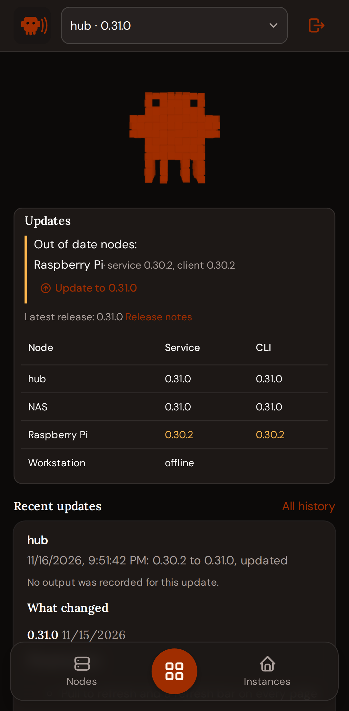 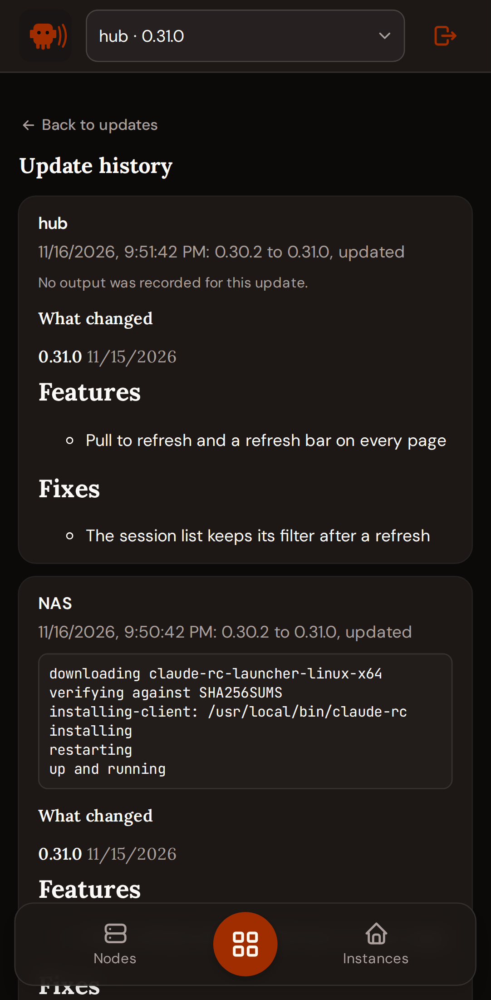

Read [Updates](updates.md) for the rules.

## Appearance

The Appearance page has four color themes (Claude, Grape, Ayu and Tokyo Night) and three modes (System, Light and Dark). System follows the setting of your device. The browser stores the choice, so each device keeps its own choice.

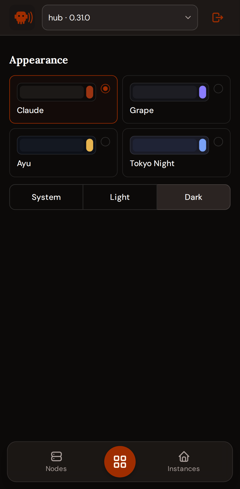
